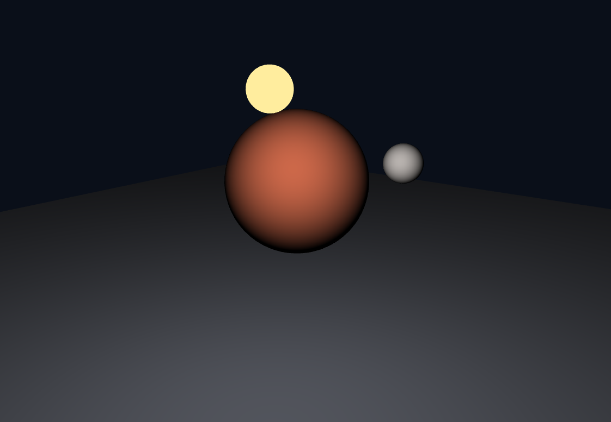
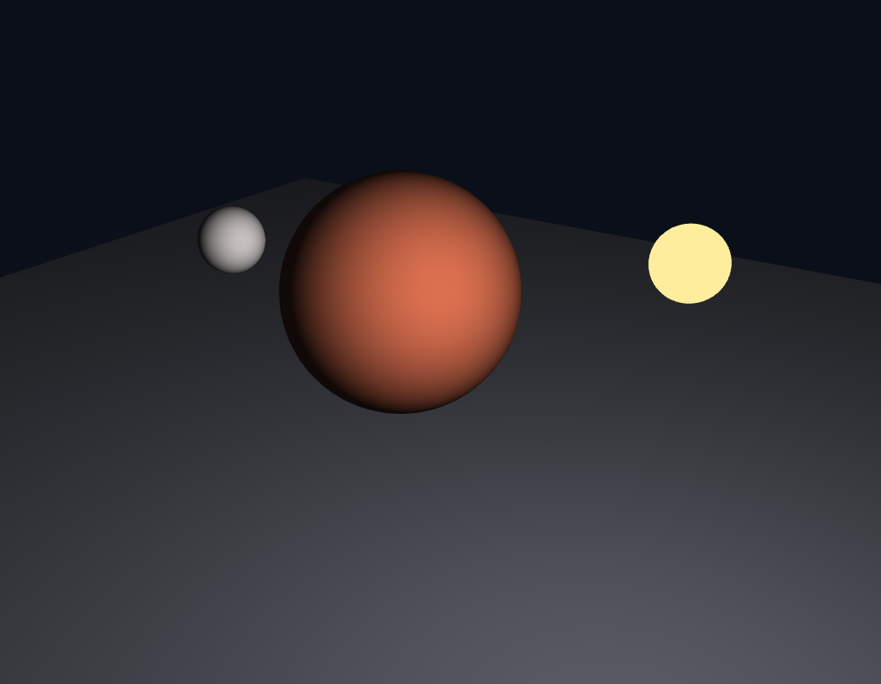
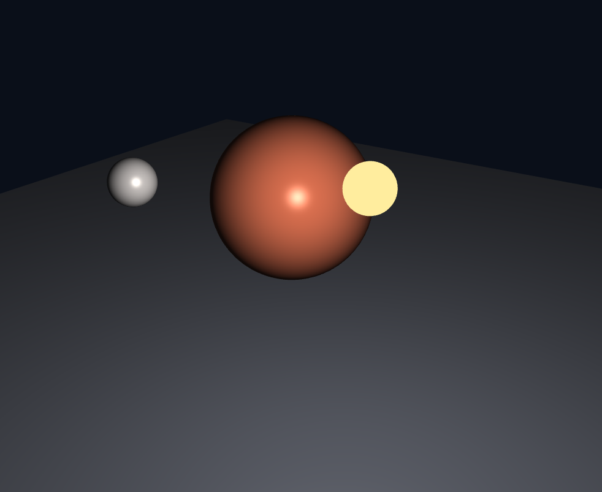
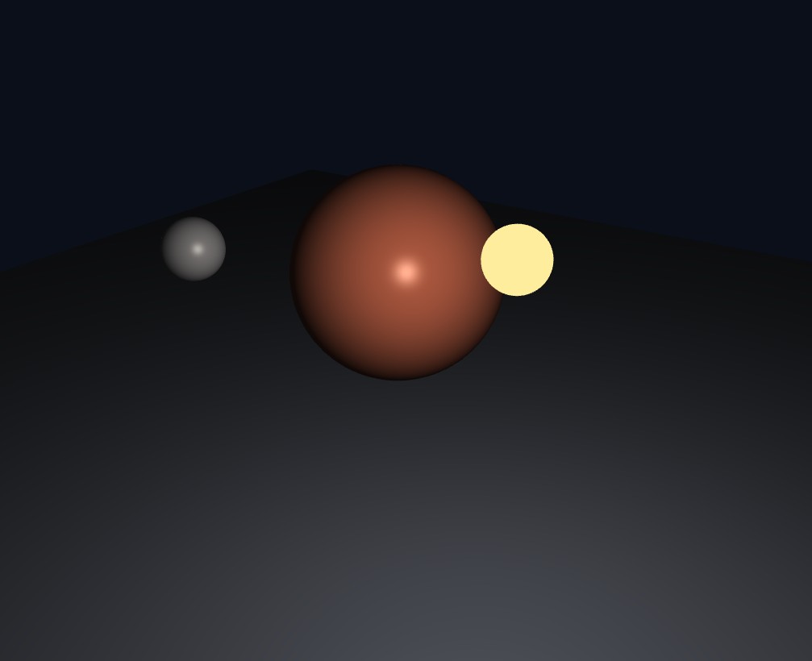
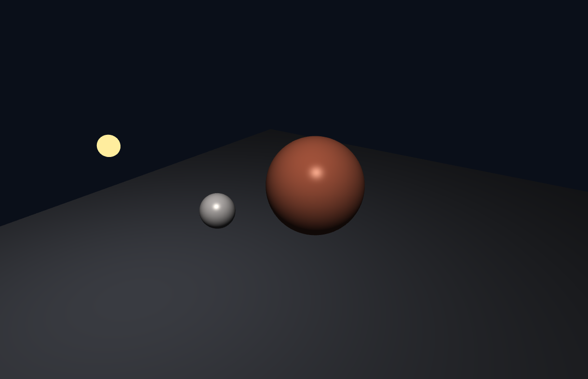

# 5주차 실습 1 보고서

## 1. 단계 1~4 적용 캡처

같은 각도에서 단계별로 조명 항을 하나씩 더해 가며 캡처했습니다.

### 1단계 — 확산 반사 (diffuse)

### 2단계 — 환경광 (ambient) 추가

### 3단계 — 정반사 (specular) 추가

### 4단계 — 거리 감쇠 (attenuation) 적용

## 2. 단계 1의 `max` 제거 예측과 실제 결과

- **예측**: `max(dot(N, L), 0.0)` 에서 `max` 를 지우면 빛을 등진 쪽의 내적이 음수가 되어, 구가 깨지거나 아예 사라질 것이라고 예측했습니다.
- **실제 결과**: 구가 사라지지는 않았습니다. 1단계에서는 화면이 거의 그대로였습니다. 빛을 등진 쪽의 `dot(N, L)` 은 음수가 되지만, 색이 화면에 쓰일 때 0 미만의 값은 0 으로 잘려서 검게 보이기 때문입니다.
- **알게 된 점**: 값 자체는 음수로 남아 있어서, 2단계처럼 ambient 를 더하면 음수인 diffuse 가 ambient 를 깎아 내어 밤 쪽이 더 어두워지고 명암 경계도 달라질 수 있습니다. 그래서 `max` 는 "빛이 닿지 않는다"를 정확히 0 으로 만들어 주는 역할을 하므로 지우면 안 됩니다.

## 3. 단계 5의 비교 캡처 (비균등 스케일 상태)

### `mat3(uModel)` 을 쓴 경우

일때%20조명.png)

### `uNormalMat` 을 쓴 경우

- 모델 행렬을 그대로 곱하면 비균등 스케일에서 법선이 표면과 수직이 아니게 되어 조명의 밝은 쪽 위치가 어긋납니다.
- 법선 행렬(모델 행렬의 역전치 행렬)을 쓰면 늘어난 표면에서도 법선이 표면에 수직으로 유지되어 밝은 쪽이 올바른 위치에 나타납니다.

## 4. 단계 6 — 광원 종류를 바꾼 결과와 달라진 점

기존 point 광원을 **directional** 로 바꾸고, **spot** 광원을 하나 추가했습니다.

- **point 광원**: 한 점에서 사방으로 퍼지므로 픽셀마다 광원 쪽 방향 `L` 이 다르고 거리 감쇠 `att` 도 적용됩니다. 그래서 광원에 가까운 바닥과 구가 더 밝습니다.
- **directional 광원**: 위치 없이 방향 하나(`normalize(vec3(0.4, 0.8, 0.5))`)만 쓰고 `att = 1.0` 으로 두었습니다. 모든 픽셀에서 `L` 이 같고 바닥 법선도 `(0, 1, 0)` 으로 같아서, 바닥 평면 전체가 위치와 상관없이 균일한 밝기로 바뀌었습니다.
- **spot 광원**: 4-3 절대로 point 와 똑같이 `L` 과 `att` 를 구한 뒤, 광원이 향하는 방향 `uSpotDir` 을 `(0, -1, 0)` (바닥 방향)으로 두었습니다. `c = dot(-L, normalize(uSpotDir))` 로 원뿔 축과 이루는 각의 cos 를 구하고, 안쪽 각 16°와 바깥 각 28°의 cos 값 사이를 `clamp` 로 줄여 `att` 에 곱했습니다. 그 결과 광원 아래 바닥에 가장자리가 부드러운 원형의 조명 영역이 생겼고, 원 바깥은 directional 광원의 빛만 남았습니다.
- 각도 대신 cos 값끼리 비교한 이유는 `dot` 이 바로 cos 를 주기 때문에, 픽셀마다 `acos` 를 호출하는 낭비를 피할 수 있어서입니다.