# 5주차 실습 1

(https://hongchaeyeon413.github.io/cg-2026-solar/week5/task1.html)

## 1. 단계 1~4 적용 캡처

같은 각도에서 단계별로 조명 항을 하나씩 더해 가며 캡처했습니다.

### 1단계 — 확산 반사 (diffuse)

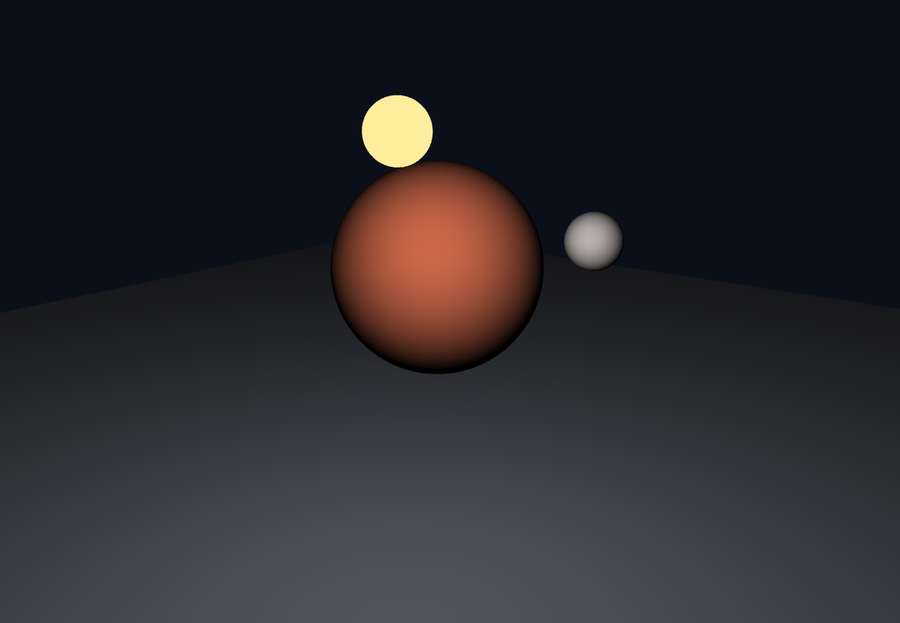

### 2단계 — 환경광 (ambient) 추가

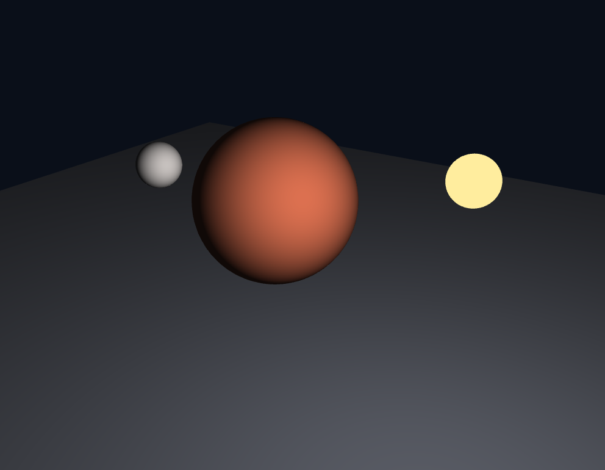

### 3단계 — 정반사 (specular) 추가

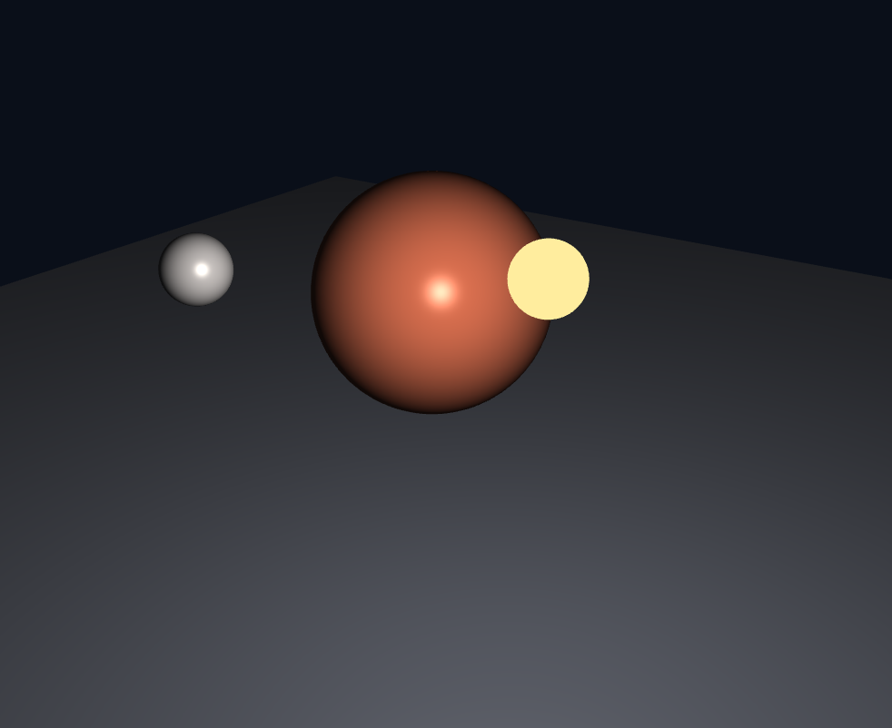

### 4단계 — 거리 감쇠 (attenuation) 적용

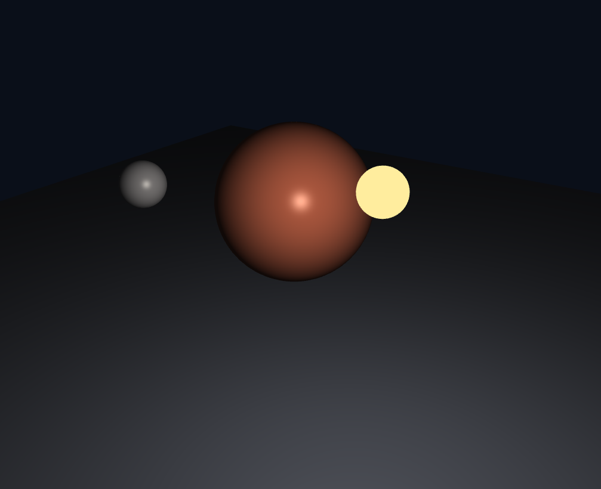

## 2. 단계 1의 `max` 제거 예측과 실제 결과

- **예측**: `max(dot(N, L), 0.0)` 에서 `max` 를 지우면 빛을 등진 쪽의 내적이 음수가 되어, 구가 깨지거나 아예 사라질 것이라고 예측했습니다.
- **실제 결과**: 구가 사라지지는 않았습니다. 1단계에서는 화면이 거의 그대로였습니다. 빛을 등진 쪽의 `dot(N, L)` 은 음수가 되지만, 색이 화면에 쓰일 때 0 미만의 값은 0 으로 잘려서 검게 보이기 때문입니다.
- **알게 된 점**: 값 자체는 음수로 남아 있어서, 2단계처럼 ambient 를 더하면 음수인 diffuse 가 ambient 를 깎아 내어 밤 쪽이 더 어두워지고 명암 경계도 달라질 수 있습니다. 그래서 `max` 는 "빛이 닿지 않는다"를 정확히 0 으로 만들어 주는 역할을 하므로 지우면 안 됩니다.

## 3. 단계 5의 비교 캡처 (비균등 스케일 상태)

### `mat3(uModel)` 을 쓴 경우

일때%20조명.png)

### `uNormalMat` 을 쓴 경우

- 모델 행렬을 그대로 곱하면 비균등 스케일에서 법선이 표면과 수직이 아니게 되어 조명의 밝은 쪽 위치가 어긋납니다.
- 법선 행렬(모델 행렬의 역전치 행렬)을 쓰면 늘어난 표면에서도 법선이 표면에 수직으로 유지되어 밝은 쪽이 올바른 위치에 나타납니다.

## 4. 단계 6 — 광원 종류를 바꾼 결과와 달라진 점

기존 point 광원을 **directional** 로 바꾸고, **spot** 광원을 하나 추가했습니다.

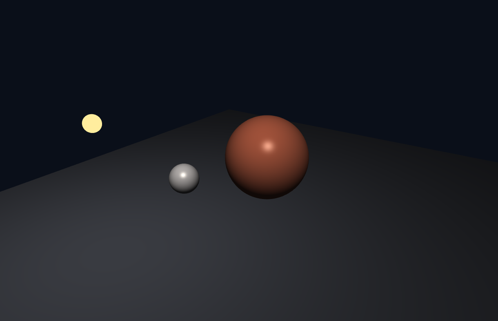

- **point 광원**: 한 점에서 사방으로 퍼지므로 픽셀마다 광원 쪽 방향 `L` 이 다르고 거리 감쇠 `att` 도 적용됩니다. 그래서 광원에 가까운 바닥과 구가 더 밝습니다.
- **directional 광원**: 위치 없이 방향 하나(`normalize(vec3(0.4, 0.8, 0.5))`)만 쓰고 `att = 1.0` 으로 두었습니다. 모든 픽셀에서 `L` 이 같고 바닥 법선도 `(0, 1, 0)` 으로 같아서, 바닥 평면 전체가 위치와 상관없이 균일한 밝기로 바뀌었습니다.
- **spot 광원**: 4-3 절대로 point 와 똑같이 `L` 과 `att` 를 구한 뒤, 광원이 향하는 방향 `uSpotDir` 을 `(0, -1, 0)` (바닥 방향)으로 두었습니다. `c = dot(-L, normalize(uSpotDir))` 로 원뿔 축과 이루는 각의 cos 를 구하고, 안쪽 각 16°와 바깥 각 28°의 cos 값 사이를 `clamp` 로 줄여 `att` 에 곱했습니다. 그 결과 광원 아래 바닥에 가장자리가 부드러운 원형의 조명 영역이 생겼고, 원 바깥은 directional 광원의 빛만 남았습니다.
- 각도 대신 cos 값끼리 비교한 이유는 `dot` 이 바로 cos 를 주기 때문에, 픽셀마다 `acos` 를 호출하는 낭비를 피할 수 있어서입니다.

# 5주차 실습 2

(https://hongchaeyeon413.github.io/cg-2026-solar/week5/task2.html)
 
## 1. 의도
 
우주 공간에는 공기가 거의 없어서 빛이 닿지 않는 쪽은 거의 완전한 어둠이 됩니다. 이 장면은 그 점을 살려서, 따뜻한 태양빛과 약하고 차가운 먼 별빛이 서로 다른 방향에서 행성을 비추는 **태양계**를 만들려고 했습니다. 행성 크기는 실제 비율을 따랐고(지구 반지름 기준), 행성마다 표면 재질이 확연히 달라 보이도록 해서 같은 조명에서도 암석 행성, 가스 행성, 얼음 행성이 구분되게 했습니다.
 
## 2. 방법
 
### 2-1. 광원
 
| 번호 | 종류 | 의미 | 위치 / 방향 | 색 | 감쇠 | 키 |
|---|---|---|---|---|---|---|
| ① | **point** | 태양 | 장면 중심 `(0, 0, 0)` | `(2.6, 2.35, 1.95)` — **따뜻한 흰빛** | 있음: `1 / (1 + 0.00009·d²)` | `1` |
| ② | **directional** | 먼 다른 별 | 빛의 진행 방향 `(0.40, -0.25, -0.85)` | `(0.18, 0.28, 0.60)` — **차가운 파랑** | 없음 | `2` |
| ③ | 자체발광 효과 | 태양 코로나, 지구 밤 쪽 도시 불빛 | — | 주황색 / 노란색 | — | `3` |
 
- ③은 광원이 아니라 스스로 내는 빛(emissive) 효과를 켜고 끄는 키입니다. 광원은 ①, ② 두 개이고 종류는 point와 directional 두 가지입니다.
- point 광원은 픽셀마다 광원 방향이 달라서 거리에 따라 어두워지고, directional 광원은 모든 픽셀에서 방향이 같습니다.
- 태양 구는 조명 계산을 하지 않는 자체발광 구라서, `1` 키로 태양 광원을 꺼도 구 자체는 항상 밝게 보입니다.
### 2-2. 조명 계산
 
- 반사 모델은 Phong이고, 계산은 모두 월드 좌표에서 합니다. `vWorldPos`, `uSunPos`, `uViewPos`를 같은 좌표계로 맞췄습니다.
- 법선은 모델 행렬이 아니라 법선 행렬(`uNormalMat`)로 변환하고, 프래그먼트 셰이더에서 `normalize(vNormal)`로 다시 정규화합니다.
- 반사 벡터는 `reflect(-L, N)`로 구하고, `dot(N, L) > 0`일 때만 specular를 더합니다. 그래서 물체 뒤쪽에는 하이라이트가 생기지 않습니다.
- ambient는 `0.015`로 매우 낮게 두었습니다. 우주 공간이라 빛이 닿지 않는 쪽을 어둡게 보이게 하려는 의도입니다.
- 마지막에 노출 보정과 감마 보정(`pow(…, 1/2.2)`)을 `finish()` 함수로 적용해서 밝은 값이 하얗게 타지 않게 했습니다.
- 카메라를 돌려도 밤낮 경계는 그대로이고 하이라이트만 움직입니다. 조명이 월드 좌표 기준이고, 매 프레임 카메라 위치(`uViewPos`)만 새로 넘기기 때문입니다.
### 2-3. 재질
 
재질은 세 가지 값으로 나눴습니다. 과제문의 `uShininess`는 셰이더 안의 `shin` 변수가 맡고 있습니다.
 
- `alb`: 물체색 (표면 무늬는 잡음 함수로 생성)
- `shin`: 광택의 폭 (클수록 하이라이트가 좁고 날카로움)
- `ks`: 광택의 세기
| 천체 | 종류 | `shin` | `ks` | 특징 |
|---|---|---|---|---|
| 수성 | 암석 | 6 | 0.03 | 크레이터, 거의 무광 |
| 금성 | 암석 | 18 | 0.06 | 황백색 구름 |
| 지구 | 암석 | 바다 120 / 땅 8 | 바다 0.90 / 땅 0.05 | 바다는 반짝, 땅은 무광, 구름·극관·도시 불빛 |
| 화성 | 암석 | 8 | 0.04 | 붉은 표면 |
| 목성 | 가스 | 28 | 0.12 | 줄무늬와 대적점 |
| 토성 | 가스 | 22 | 0.08 | 금빛 줄무늬, 고리와 그림자 |
| 천왕성 | 얼음 | 50 | 0.25 | 매끈한 청록색 |
| 해왕성 | 얼음 | 50 | 0.25 | 짙은 파랑, 대흑점 |
| 달 | 위성 | 5 | 0.02 | 회색 암석, 크레이터 |
 
같은 조명 아래에서 지구 바다(`shin` 120)와 달(`shin` 5)은 하이라이트의 크기와 선명함이 극단적으로 다르게 보입니다. 암석 행성은 `shin`을 작게, 얼음 행성은 크게 주었습니다.
 
### 2-4. 조작
 
| 키 | 기능 |
|---|---|
| `1` `2` `3` | 태양(point) / 먼 별빛(directional) / 자체발광 효과 켜기·끄기 |
| `←` `→` | 보는 천체 선택 |
| `P` | 시간 멈춤·재개 |
| `↑` `↓` | 시간 속도 조절 |
| `O` / `L` | 궤도선 / 이름표 표시 |
| 드래그, 휠 | 시점 회전, 확대·축소 |
 
## 3. 광원을 하나씩 끈 캡처
 
 
| 상태 | 캡처 | 확인할 점 |
|---|---|---|
| 전부 켬 | 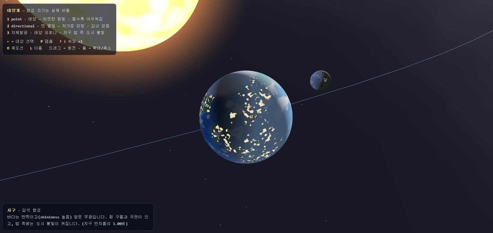 | 기준 장면 |
| `1` 끔 (태양 꺼짐) | 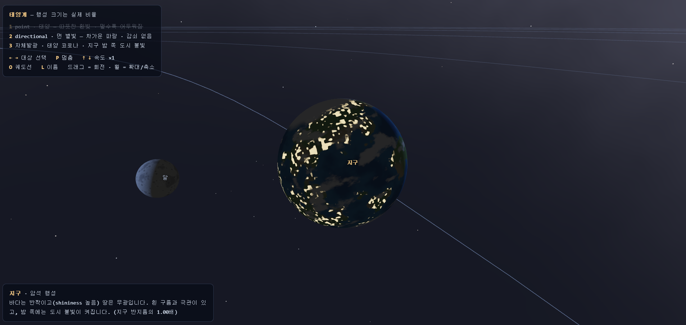 | 행성이 거의 어두워지고 파란 별빛만 한쪽 면을 약하게 비춥니다. 태양 구는 자체발광이라 그대로 밝습니다. |
| `2` 끔 (별빛 꺼짐) | 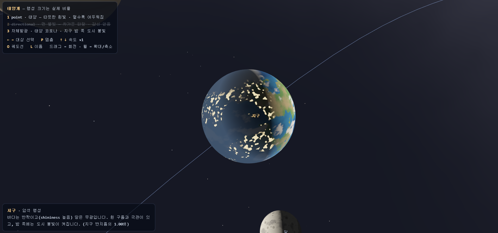 | 태양이 비추지 않는 쪽이 완전히 검어집니다. 파란 기운이 사라집니다. |
| `3` 끔 (자체발광 꺼짐) | 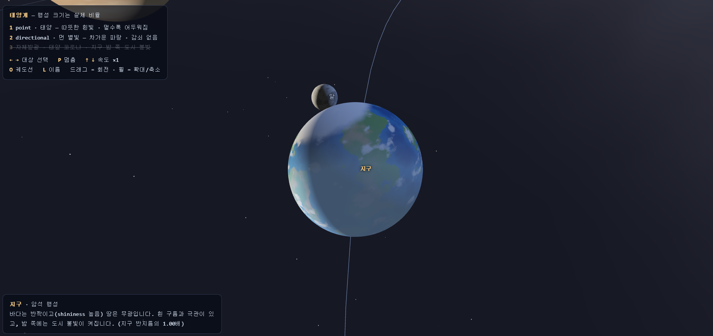 | 코로나가 사라지고 지구 밤 쪽 도시 불빛이 꺼집니다. 조명(Phong) 결과는 변하지 않습니다. |
 
## 4. 최종 캡처
 
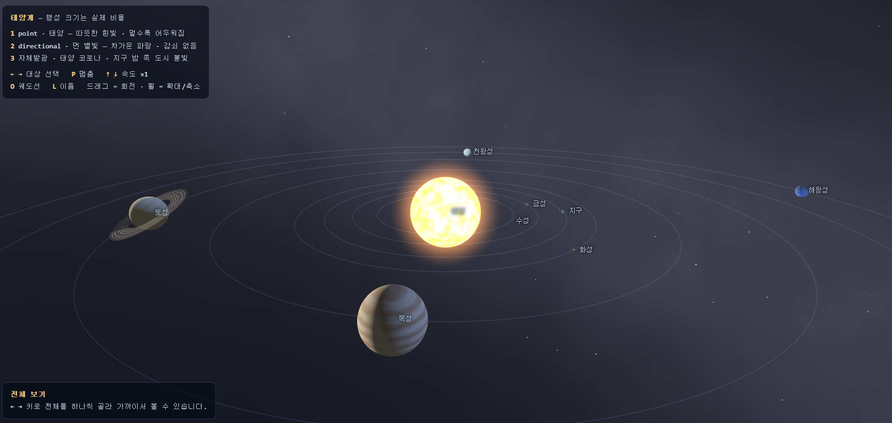
 
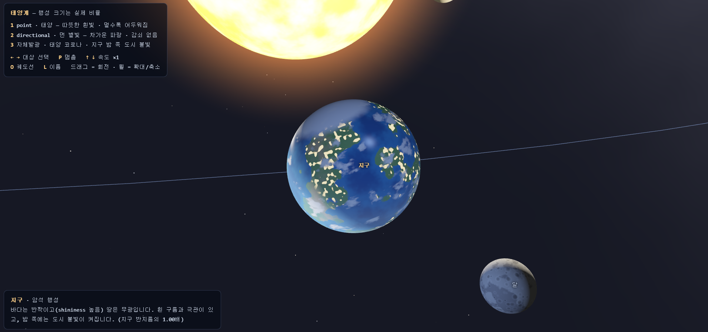
 
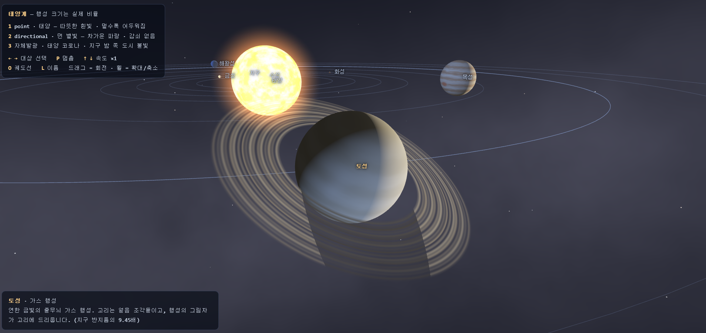
 
- 전체 장면: 행성 크기 비율과 궤도
- 지구: 바다의 날카로운 하이라이트, 땅의 무광, 밤 쪽 도시 불빛
- 토성: 고리가 행성의 그림자를 받는 모습

## 5. AI 사용
 
 ### 장면은 직접 정했습니다
- **장면: 태양계.** 태양(point)과 먼 별(directional)이라는 서로 다른 두 종류의 광원이
  자연스럽게 대응되고, 암석·가스·얼음 행성의 재질 차이가 한눈에 보이는 장면이라서 골랐습니다.

### 요청한 것
1. 수업 자료의 "해야 할 것" 5개 항목(광원 2개 이상·서로 다른 종류 2가지, 광원별 색 구분,
   물체별 재질 구분, 키보드로 광원 켜고 끄기, 한눈에 읽히는 장면)을 그대로 보여 주고,
   **장면은 태양계로 지정**해서 실제 태양계 행성들 간 크기 비례가 맞게 `task2.html`을 만들어 달라고 요청했습니다.
2. 완성된 코드를 받은 뒤, 과제 체크리스트와 "AI가 자주 틀리는 곳" 표를 기준으로
   항목별로 맞는지 확인해 달라고 다시 요청했습니다.

### 결과를 보고 고친 것
- 점검 결과 **광원 표시 구(태양)가 광원을 끄면 같이 어두워지는 문제**가 있었습니다.
  `1` 키로 태양 광원을 꺼도 태양 구는 자체발광이라 항상 밝게 보이도록 고쳤습니다.
  (코로나는 `3` 키로만 켜고 끕니다.)

### 직접 확인한 것
- 법선 행렬 사용, 법선 정규화, 월드 좌표 통일, `reflect(-L, N)` 부호, ambient 크기 등
  "AI가 자주 틀리는 곳" 항목을 코드에서 하나씩 확인했습니다.
