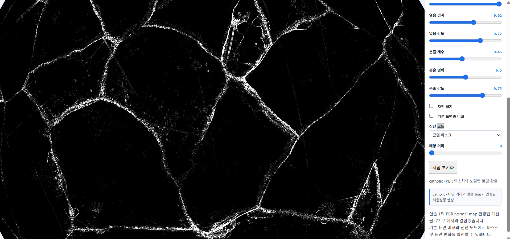
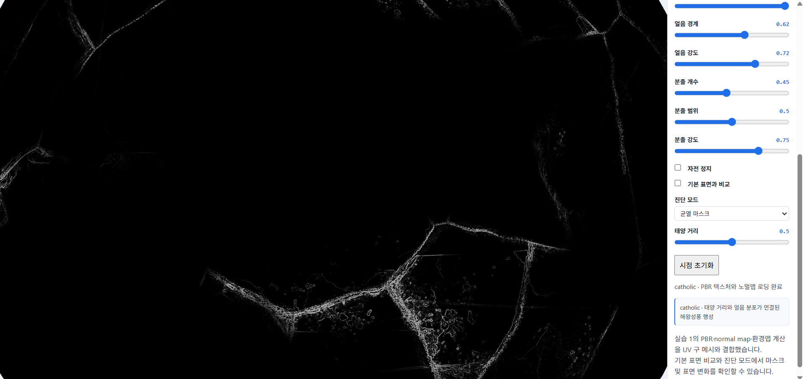
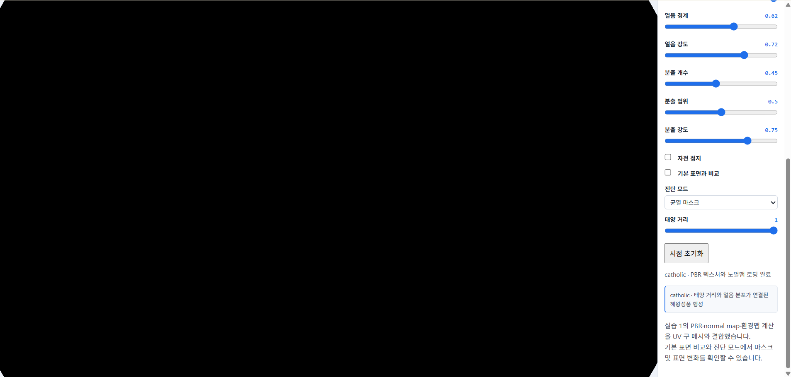
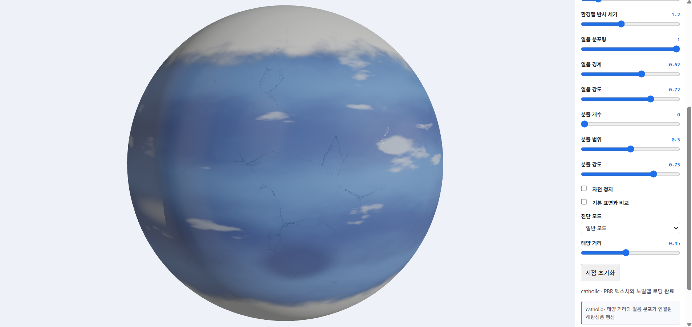
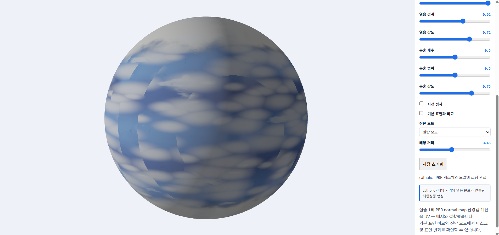
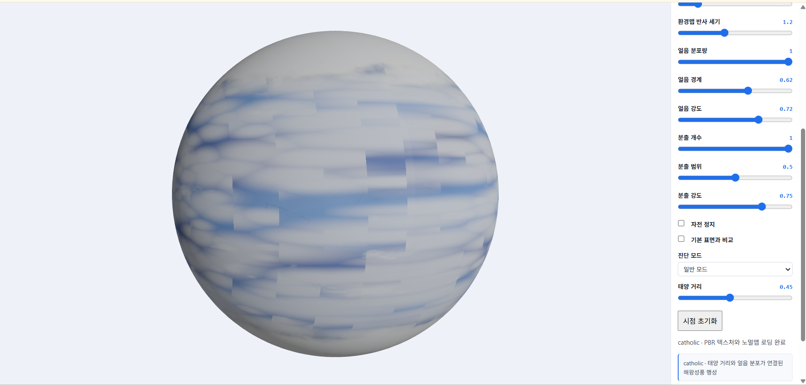
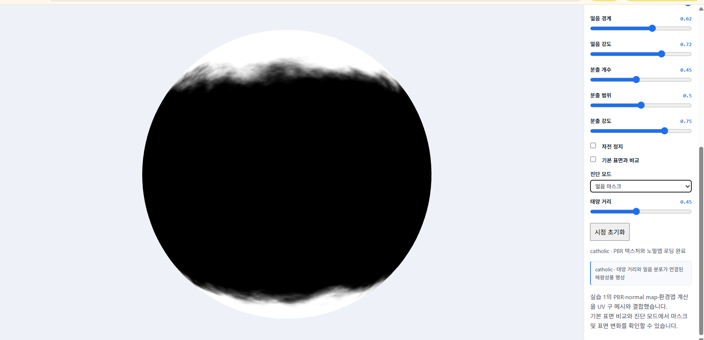
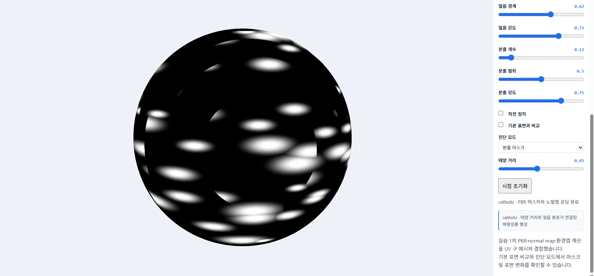
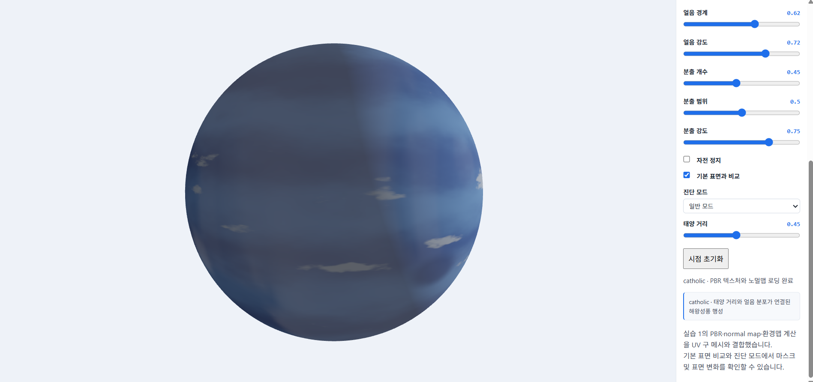
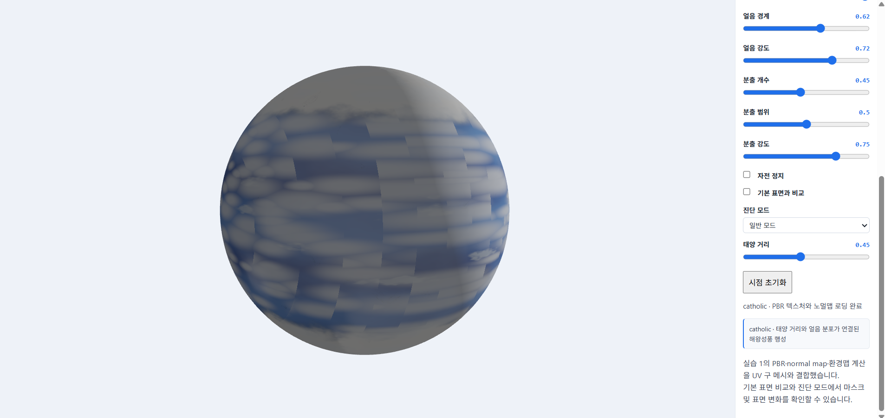

# 6주차 실습 1

(http://127.0.0.1:5500/week6/task1.html)

## 0. 개요

- 목표: 회색 Phong 큐브를 색 맵 → PBR 직접광 → ARM 맵 → 법선 맵 → 환경맵 순서로 발전시켜, 같은 큐브가 다른 재료로 보이게 만드는 것입니다.
- 완성한 항목: TODO 1 · 2 · 3 · 4 · 5 모두 `task1.js`에 작성하였습니다.
- 코드 출처: 수업 페이지의 단계별 코드를 해당 TODO 자리에 넣었습니다. 단계마다 저장하고 새로고침해서 화면과 슬라이더로 확인하였습니다. (7장 참고)
- 기본 슬라이더 값: roughness 배율 1 · metallic 배율 1 · normal 강도 5 · 직접광 4 · ambient 0.15 · 환경맵 1.5입니다.
- 같은 큐브(정점, 메시)를 계속 사용합니다. 바뀐 것은 셰이더의 계산뿐입니다.

## 1. 같은 시점 비교 (단계 1 · 3 · 4)

녹슨 금속, 같은 시점, 같은 슬라이더 값에서 단계별로 비교한 결과입니다.

| 단계 1 (색 맵만) | 단계 3 (ARM 적용) | 단계 4 (법선 맵 적용) |
|---|---|---|
|  |  |  |

| 단계 | 달라진 점 |
|---|---|
| 1 → 3 | 색 맵만 적용했을 때는 표면에 녹슨 무늬와 색상만 나타났지만, ARM 맵을 적용한 후에는 위치별 roughness와 metallic 값에 따라 반사의 강도와 형태가 달라졌습니다. 금속 부분과 녹이 슨 부분의 재질 차이가 더 뚜렷해졌습니다. |
| 3 → 4 | 법선 맵을 적용하자 표면의 작은 흠집과 요철에 따라 빛과 그림자가 달라졌습니다. 하이라이트도 표면의 굴곡에 맞춰 불규칙하게 나타났지만 큐브의 외곽선과 전체 형태는 변하지 않았습니다. |

## 2. 금속 영역과 녹 영역의 차이

| 금속이 드러난 부분 | 녹이 슨 부분 |
|---|---|
|  |  |

| 항목 | 금속 영역 | 녹 영역 |
|---|---|---|
| metallic (B 채널) | 높음 (1에 가까움) | 낮음 (0에 가까움) |
| 정반사색 `F0` | base색 | 약 0.04 (회색) |
| 확산 반사 `kd` | 거의 없음 | 뚜렷함 |
| 하이라이트 | 밝고 base색을 띰 | 약하고 넓게 퍼짐 |

- 같은 큐브, 같은 조명인데도 영역마다 ARM 값이 다르기 때문에 반사 방식이 달라집니다. 금속은 반사가 색을 만들고, 녹은 확산이 색을 만듭니다.
- 확인: 금속 영역은 metallic 값이 높아 base 색상을 반사색으로 사용하고 확산 반사는 거의 나타나지 않았습니다. 반면 녹 영역은 metallic 값이 낮아 약 0.04의 회색 정면 반사율을 가지며, 확산 반사가 더 뚜렷하게 나타났습니다. 따라서 같은 큐브에서도 금속 부분은 색이 있는 반사광이 나타나고, 녹 부분은 표면 고유의 색이 더 잘 드러납니다.

## 3. 재질 비교 (녹슨 금속 · 나무 · 돌)

같은 시점, 같은 슬라이더 값에서 재질만 바꾸어 비교한 결과입니다.

| 녹슨 금속 | 나무 | 돌 |
|---|---|---|
|  |  |  |

- 나무와 돌은 B 채널이 거의 검정이라 metallic 배율을 올려도 금속처럼 변하지 않습니다.
- 색 맵, 법선 맵, ARM 맵이 재질마다 다르기 때문에 같은 조명에서도 하이라이트, 요철, 반사 세기가 다르게 보입니다.
- 확인: 녹슨 금속은 금속 부분의 반사와 녹 부분의 거친 표면이 함께 나타났습니다. 나무는 나뭇결 무늬와 표면 요철이 보이며 금속처럼 강한 반사가 나타나지 않았습니다. 돌은 불규칙한 표면 질감과 거친 요철이 나타나고, 나무와 마찬가지로 확산 반사가 주로 나타났습니다. 재질마다 색 맵, ARM 맵, 법선 맵이 다르기 때문에 같은 조명에서도 서로 다른 재질처럼 보였습니다.

## 4. 필터링 비교

- 설정 A: NEAREST_MIPMAP_NEAREST
- 설정 B: LINEAR_MIPMAP_LINEAR

- **차이:** 설정 A는 가장 가까운 밉맵 단계와 텍셀을 선택하여 표현하므로 픽셀이나 텍스처의 경계가 상대적으로 뚜렷하게 나타납니다. 반면 설정 B는 주변 텍셀과 밉맵 단계 사이의 색상을 보간하므로 상대적으로 부드럽게 표현됩니다.
- **이유:** 두 설정은 텍스처가 화면에서 축소될 때 사용할 밉맵 단계와 텍셀의 색상을 결정하는 방식이 다르기 때문입니다. 이러한 차이로 인해 텍스처의 선명도와 계단 현상 등이 다르게 나타날 수 있습니다.

## 5. 검증: 모든 빛을 껐을 때

직접광 세기 0, 상수 ambient 0, 환경맵 반사 0으로 설정하였습니다.


- 결과: 큐브가 검게 보입니다.
- 이유: 이 셰이더에는 스스로 빛나는 항(emissive)이 없습니다. 모든 색은 **받는 빛 × 반사율**이어서, 직접광·ambient·환경 반사가 모두 0이면 `color`가 0이 되고 톤매핑과 sRGB 변환 후에도 0입니다. 비발광 물체는 빛이 없으면 어두워야 하며, 실제로 그렇게 나타났습니다.


# 6주차 실습 2

(http://127.0.0.1:5500/week6/task2.html)

## 1. 행성 설정

### 1-1. CATHOLIC 행성의 환경 설정

이번 실습에서는 해왕성의 푸른 색감에서 영감을 얻은 가상의 행성 **CATHOLIC**을 제작하였습니다.

CATHOLIC은 푸른색을 기본으로 하는 얼음 행성이며, 표면에는 얼음 지형과 불규칙한 균열, 내부 활동으로 형성된 분출 흔적이 존재한다는 설정입니다.

행성의 표면을 하나의 이미지로 단순하게 표현하는 대신, 셰이더에서 행성 표면의 위치와 노이즈를 이용하여 여러 마스크를 계산하고, 각 영역에 서로 다른 색상과 재질을 적용하였습니다.

행성은 UV 구 메시를 사용하였으며, Y축을 중심으로 회전하도록 구현하였습니다. 태양은 발광하는 구체로 표현하고 행성과 함께 하나의 3D 장면에 배치하였습니다.


### 1-2. 행성 표면의 구성

CATHOLIC의 표면은 세 가지 요소로 구성하였습니다.

- **기본 얼음 지형:** 위도와 FBM 노이즈를 이용하여 얼음 영역을 불규칙하게 생성합니다.
- **표면 균열:** 태양과의 거리 값에 따라 균열의 강도가 달라집니다.
- **분출 흔적:** 내부 분출 활동 설정값에 따라 표면 흔적의 밀도와 크기가 달라집니다.

이 중 태양 거리와 분출 활동을 두 가지 주요 환경 변화 조건으로 설정하였습니다. 얼음 지형은 행성의 기본적인 표면 환경을 구성하는 별도의 요소입니다.

---

## 2. 두 가지 표면 변화 규칙과 코드 구현

이번 프로젝트에서는 환경 조건이 달라질 때 행성 표면의 서로 다른 영역이 변화하도록 두 가지 규칙을 구현하였습니다.

### 2-1. 첫 번째 규칙 — 태양 거리 변화에 따른 표면 균열

첫 번째 규칙은 태양과 행성 사이의 거리에 따라 표면 균열의 강도가 달라지는 것입니다.

사용자가 `Solar Distance` 슬라이더를 조절하면 JavaScript에서 광원의 위치와 밝기를 변경하고, 셰이더에 해당 값을 전달합니다.

**코드 위치: JavaScript의 태양 거리 및 광원 업데이트 부분 (`solarDistance`)**

```javascript
const solarDistance = S.solarDistance;

light[0] = 1.8 + .9 * solarDistance;
light[1] = 1.0 + .5 * solarDistance;
light[2] = 2.4 + 1.2 * solarDistance;

gl.uniform1f(U.uSolarDistance, solarDistance);
gl.uniform1f(U.uSolarLight, 1.15 - .43 * solarDistance);
```

태양 거리 값이 증가하면 광원의 위치가 멀어지고 직접 조명의 밝기는 감소합니다. 또한 `uSolarDistance` 값은 셰이더로 전달되어 균열의 강도를 결정합니다.

**코드 위치: 셰이더의 `crackMask()` 함수**

```glsl
float crackAmount = 1.0 - uSolarDistance;
```

위 식에 따라 태양 거리 값이 낮을수록 균열 강도가 커지고, 값이 높을수록 균열 강도가 작아집니다.

균열이 나타나는 위치는 FBM 노이즈를 이용하여 불규칙하게 결정합니다. 여기에 얼음 노멀맵의 정보를 추가로 활용하여 균열이 나타나는 영역을 계산합니다.

따라서 첫 번째 규칙은 태양 거리라는 환경 변수가 광원의 위치와 밝기뿐만 아니라 표면 균열의 강도에도 영향을 주도록 구현한 것입니다.

### 2-2. 두 번째 규칙 — 내부 분출 활동에 따른 표면 흔적

두 번째 규칙은 행성 내부의 분출 활동 정도에 따라 표면에 생성되는 흔적이 달라지는 것입니다.

CATHOLIC 내부에서 발생하는 에너지 활동이 표면에 흔적을 남긴다는 가상의 설정을 적용하였습니다.

**코드 위치: 셰이더의 `eruptionDistance()` 및 `eruptionMask` 계산 부분**

표면을 셀 단위로 구분하고 해시값을 이용하여 각 영역에 흔적이 생성될 위치를 결정합니다. 이후 각 위치와 흔적 중심 사이의 거리를 계산하여 흔적이 나타나는 영역을 마스크로 만듭니다.

이 과정에서 다음 두 변수를 사용합니다.

- `uCraterAmount`: 표면에 생성되는 흔적의 밀도와 개수를 조절합니다.
- `uCraterSize`: 흔적의 크기와 범위를 조절합니다.

`uCraterAmount`가 증가하면 흔적이 생성되는 영역이 많아지며, `uCraterSize`를 변경하면 흔적의 크기와 범위가 달라집니다.

이를 통해 표면에 동일한 무늬를 단순히 반복하는 대신, 셀과 거리 계산을 이용한 불규칙한 흔적을 생성하였습니다.

### 2-3. 기본 얼음 지형 생성 규칙

두 가지 주요 변화 규칙 외에도 CATHOLIC의 기본 환경을 표현하기 위해 얼음 지형을 추가하였습니다.

**코드 위치: 셰이더의 `iceMask()` 함수**

```glsl
float latitude = smoothstep(.28, .92, abs(S.y));
```

행성 표면의 Y축 위치를 이용하여 위도에 따른 기본 영역을 계산하고, FBM 노이즈를 결합하여 얼음이 분포하는 위치와 경계를 불규칙하게 만듭니다.

얼음 영역은 `uIceAmount`와 `uIceThreshold` 값으로 조절할 수 있습니다.

다만 현재 구현에서 얼음 마스크는 태양 거리 변수와 직접 연결되어 있지 않습니다. 따라서 얼음은 두 가지 주요 환경 변화 조건과 구분되는 기본 표면 요소입니다.

---

## 3. 첫 번째 조건 — 태양 거리 값에 따른 표면 변화

태양 거리 값을 0, 0.5, 1로 변경하여 광원과 표면 균열의 변화를 비교하였습니다.

모든 이미지는 카메라 시점을 동일하게 유지하고 태양 거리 값만 변경하여 비교합니다.

### 3-1. 태양 거리 0

태양 거리 값이 0인 상태입니다. 코드에서 `crackAmount`는 1이 되므로 균열 강도가 가장 크게 설정됩니다. 광원도 거리 값에 따른 위치 및 밝기 계산의 기준 상태가 됩니다.




### 3-2. 태양 거리 0.5

태양 거리 값이 0.5인 중간 상태입니다. 균열 강도는 0.5가 되며, 광원의 위치와 밝기도 중간 단계로 변경됩니다.




### 3-3. 태양 거리 1

태양 거리 값이 1인 상태입니다. `crackAmount`가 0이 되어 균열 효과가 사라지도록 계산됩니다. 광원은 가장 멀리 이동하고 직접 조명의 밝기는 가장 낮게 설정됩니다.




### 3-4. 변화 결과 비교

| 태양 거리 값 | 균열 강도 (`crackAmount`) | 광원 변화 |
|---|---:|---|
| 0 | 1.0 | 기준 위치 및 밝기 |
| 0.5 | 0.5 | 중간 위치 및 밝기 |
| 1 | 0.0 | 가장 먼 위치 및 낮은 밝기 |

태양 거리 값이 증가할수록 균열 강도가 감소하도록 구현하였습니다. 또한 광원의 위치와 직접 조명 밝기도 함께 변경되므로 환경 변수 하나가 조명과 표면 변화에 동시에 영향을 주는 구조입니다.

---

## 4. 두 번째 조건 — 내부 분출 활동에 따른 표면 변화

두 번째 조건에서는 분출 활동 설정값을 변경하여 표면 흔적이 어떻게 달라지는지 비교하였습니다.

동일한 카메라 시점을 유지하고 분출 활동 값을 0, 0.5, 1로 변경하였습니다.

### 4-1. 분출 활동 0

분출 활동 값이 0인 상태입니다. 흔적이 생성되는 정도가 최소화되어 표면의 분출 흔적이 나타나지 않거나 최소한으로 나타납니다.




### 4-2. 분출 활동 0.5

분출 활동 값이 0.5인 중간 상태입니다. 표면의 일부 영역에 분출 흔적이 나타나며, 낮은 설정값과 비교하여 흔적의 분포가 달라집니다.




### 4-3. 분출 활동 1

분출 활동 값이 1인 상태입니다. 흔적이 생성되는 영역이 가장 많아지도록 설정됩니다.




### 4-4. 변화 결과 비교

분출 활동 값에 따라 표면에 흔적이 생성되는 정도가 달라집니다. 특히 `uCraterAmount`는 흔적의 밀도와 생성 정도를 조절하고, `uCraterSize`는 흔적의 크기와 범위를 조절합니다.

따라서 두 변수는 서로 다른 역할을 수행하며, 이를 통해 표면에 나타나는 분출 흔적을 세부적으로 조절할 수 있습니다.

---

## 5. 두 가지 흑백 마스크 확인

표면 변화가 적용되는 영역을 확인하기 위해 두 가지 주요 조건에 해당하는 마스크를 각각 흑백으로 출력하였습니다.

마스크는 특정 표면 영역에 효과를 적용하기 위해 셰이더에서 계산하는 값입니다. 흰색에 가까울수록 해당 효과가 강하게 적용되는 영역이며, 검은색에 가까울수록 효과가 적게 적용되는 영역입니다.

### 5-1. 첫 번째 마스크 — 얼음 마스크 (Ice Mask)

얼음 마스크는 행성 표면에서 얼음 재질이 적용될 영역을 결정하는 흑백 마스크입니다.

셰이더에서는 표면의 위도 정보인 abs(S.y)와 FBM 노이즈를 함께 사용하여 얼음이 분포할 영역을 계산합니다. 위도 정보는 극지방에 가까운 영역일수록 얼음이 형성되기 쉽도록 하고, FBM 노이즈는 얼음이 일정한 띠 형태로만 나타나지 않고 불규칙하게 분포하도록 만듭니다.

이렇게 계산된 마스크는 얼음 색상과 얼음 노멀맵, 거칠기 등의 재질 정보를 적용할 영역을 결정하는 데 사용됩니다. 흰색에 가까운 영역일수록 얼음 마스크 값이 높고, 검은색에 가까운 영역일수록 얼음 마스크 값이 낮습니다.




### 5-2. 두 번째 마스크 — 분출 흔적 마스크 (Crater Mask)

분출 흔적 마스크는 셀과 해시값, 거리 계산을 이용하여 생성합니다.

`uCraterAmount`와 `uCraterSize`에 따라 흔적이 나타나는 영역과 범위가 달라집니다.




---

## 6. 기본 표면과 변화가 적용된 표면 비교

마지막으로 표면 효과를 적용하지 않은 기본 상태와 표면 효과를 적용한 상태를 비교하였습니다.

코드에서는 `uCompare` 값을 이용하여 표면 효과의 적용 여부를 제어합니다.

```glsl
float surfaceEffects = 1.0 - float(uCompare);
```

표면 효과 비교 모드를 활성화하면 얼음, 분출 흔적, 균열 등의 표면 효과가 최종 재질 계산에서 제외됩니다. 비교 모드를 해제하면 각 마스크와 텍스처를 이용한 표면 효과가 다시 적용됩니다.

두 상태를 비교할 때는 카메라 시점을 동일하게 유지하여 표면 효과 적용 여부에 따른 차이를 확인합니다.

### 6-1. 기본 표면

표면 효과를 적용하지 않은 상태입니다. 기본적인 푸른색 절차적 패턴과 기본 재질을 확인할 수 있습니다.




### 6-2. 표면 효과 적용 상태

얼음, 분출 흔적, 균열 마스크와 텍스처를 적용한 상태입니다. 기본 표면에 여러 표면 요소가 추가되어 색상과 재질의 차이가 나타납니다.




두 화면을 비교하면 기본적인 절차적 표면에 여러 마스크와 텍스처를 결합했을 때 표면의 색상과 질감이 어떻게 달라지는지 확인할 수 있습니다.

---

## 7. PBR 재질 및 텍스처 적용

### 7-1. 기본 표면과 얼음 텍스처

기본 표면은 셰이더의 `nereidBase()` 함수에서 계산하는 절차적 색상 패턴을 사용합니다.

얼음 영역에는 별도의 텍스처를 적용하여 기본 표면과 구분되는 재질을 표현하였습니다.

| 텍스처 | 파일명 | 기능 |
|---|---|---|
| Color | `Ice003_2K-PNG_Color.png` | 얼음 영역의 색상 |
| NormalGL | `Ice003_2K-PNG_NormalGL.png` | 얼음 표면의 미세한 굴곡 |
| Roughness | `Ice003_2K-PNG_Roughness.png` | 얼음 표면의 거칠기 |

이 텍스처들은 얼음 마스크를 이용하여 해당 영역에만 적용됩니다.

### 7-2. 노멀맵

기본 표면에는 `rock_boulder_dry_nor_gl.jpg`를 사용하고, 얼음 영역에는 `Ice003_2K-PNG_NormalGL.png`를 사용하였습니다.

노멀맵은 메시의 정점 위치를 변경하지 않고 표면의 법선 방향을 조절하여 빛의 반응을 변화시킵니다. 이를 통해 행성의 전체적인 구 형태는 유지하면서도 표면의 미세한 요철을 표현하였습니다.

### 7-3. Roughness와 Metallic

Roughness와 Metallic 슬라이더를 이용하여 표면의 거칠기와 금속성 정도를 조절할 수 있도록 구현하였습니다.

현재 ARM 텍스처는 일정한 값으로 생성되며, Roughness와 Metallic 슬라이더가 재질 계산에 반영됩니다. 얼음 영역에는 별도의 Roughness 텍스처를 추가로 적용하여 기본 표면과 다른 거칠기 특성을 표현하였습니다.

### 7-4. 환경 반사

환경 반사에는 studio_small_09_tonemapped.jpg를 사용하였습니다.

환경맵은 주변 환경의 빛이 행성 표면에 반사되는 효과를 표현하는 데 사용됩니다. 직접 조명과 주변광, 환경 반사 강도를 조절할 수 있도록 하여 조명 설정에 따른 표면의 밝기와 반사 특성을 확인할 수 있게 하였습니다.

## 8. AI 제안 중 직접 판단하고 수정한 부분

이번 실습에서는 AI 도구를 활용하여 셰이더 구현과 코드 검토를 진행하였습니다. 다만 AI가 제안한 내용을 모두 그대로 적용하지 않고, 행성의 설정과 실제 구현에 필요한 기능을 기준으로 적용 여부를 판단하였습니다.

### 8-1. 텍스처 선택 및 변경

AI가 제안한 텍스처 중 목재와 녹슨 금속 텍스처는 CATHOLIC의 얼음 행성 설정과 적합하지 않다고 판단하여 사용하지 않았습니다.

대신 얼음 표면을 표현하기 위해 Ice003의 Color, NormalGL, Roughness 텍스처를 선택하였습니다.

### 8-2. NormalGL 노멀맵 선택

노멀맵은 DirectX 방식과 OpenGL 방식에 따라 Y축 방향의 정보가 다를 수 있습니다.

이번 프로젝트에서는 Ice003_2K-PNG_NormalGL.png 파일을 사용하였습니다. 이미 NormalGL 파일이 존재하므로 별도로 DirectX 노멀맵을 사용하지 않고 해당 파일을 적용하였습니다.

### 8-3. Displacement 맵 제외

Ice003 Displacement 맵도 제공된 파일에 포함되어 있었지만, 현재 구현에서는 사용하지 않았습니다.

변위맵을 실제 표면의 높낮이 변화로 표현하려면 정점 셰이더에서 메시의 정점 위치를 변경하는 과정이 필요합니다. 이번 구현은 노멀맵과 절차적 마스크를 중심으로 표면을 표현하였으므로 Displacement 맵은 연결하지 않았습니다.

### 8-4. 기능별 적용 여부 검토

AI가 제안한 코드를 적용할 때에는 단순히 코드가 실행되는지만 확인하지 않고, 텍스처가 행성의 설정에 적합한지와 실제 셰이더에서 필요한 기능인지도 함께 검토하였습니다.

이를 통해 CATHOLIC의 기본 표면과 얼음 영역, 균열 및 분출 흔적이 서로 구분되도록 구성하였습니다.
