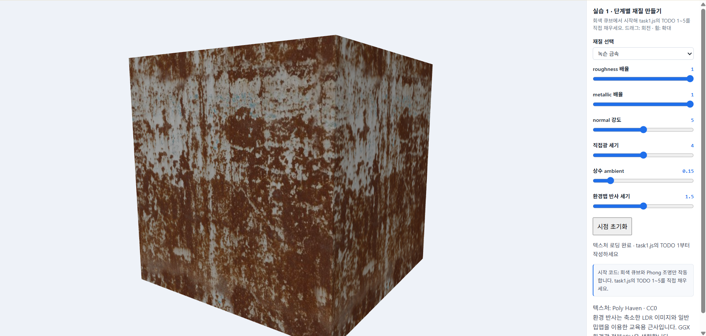
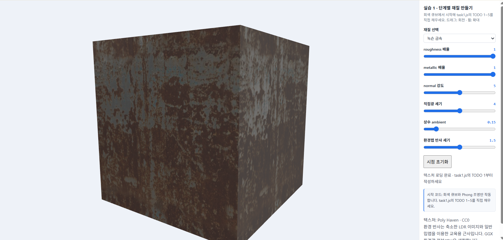
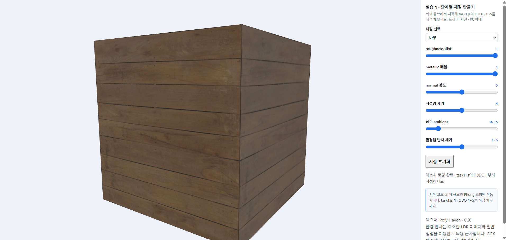
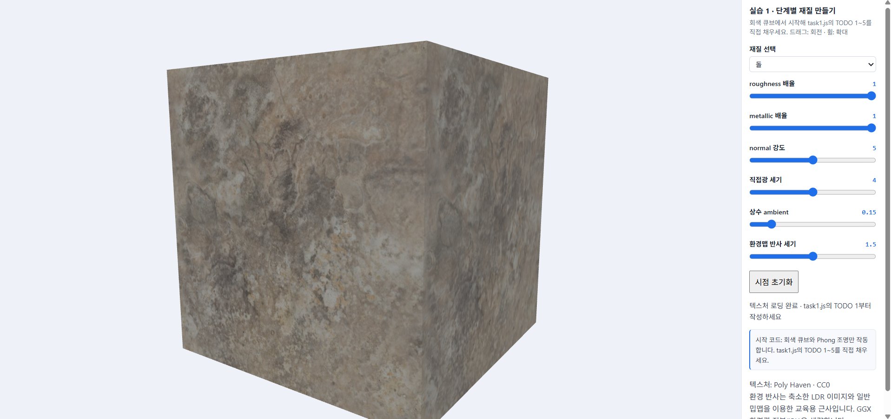
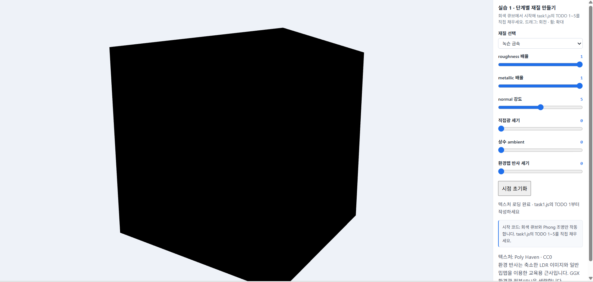

# 6주차 실습 1


## 0. 개요

- 목표: 회색 Phong 큐브를 색 맵 → PBR 직접광 → ARM 맵 → 법선 맵 → 환경맵 순서로 발전시켜, 같은 큐브가 다른 재료로 보이게 만든다.
- 완성한 항목: TODO 1 · 2 · 3 · 4 · 5 모두 `task1.js`에 작성했다.
- 코드 출처: 수업 페이지의 단계별 코드를 해당 TODO 자리에 넣었다. 단계마다 저장하고 새로고침해서 화면과 슬라이더로 확인했다. (7장 참고)
- 기본 슬라이더 값: roughness 배율 1 · metallic 배율 1 · normal 강도 5 · 직접광 4 · ambient 0.15 · 환경맵 1.5
- 같은 큐브(정점, 메시)를 계속 쓴다. 바뀐 것은 셰이더의 계산뿐이다.


## 1. 같은 시점 비교 (단계 1 · 3 · 4)

녹슨 금속, 같은 시점, 같은 슬라이더 값에서 단계별로 비교한다.

| 단계 1 (색 맵만) | 단계 3 (ARM 적용) | 단계 4 (법선 맵 적용) |
|---|---|---|
|  |  |  |

| 단계 | 달라진 점 |
|---|---|
| 1 → 3 | 색 맵만 적용했을 때는 표면에 녹슨 무늬와 색상만 나타났지만, ARM 맵을 적용한 후에는 위치별 roughness와 metallic 값에 따라 반사의 강도와 형태가 달라졌다. 금속 부분과 녹이 슨 부분의 재질 차이가 더 뚜렷해졌다. |
| 3 → 4 | 법선 맵을 적용하자 표면의 작은 흠집과 요철에 따라 빛과 그림자가 달라졌다. 하이라이트도 표면의 굴곡에 맞춰 불규칙하게 나타났지만 큐브의 외곽선과 전체 형태는 변하지 않았다. |


## 2. 금속 영역과 녹 영역의 차이

| 금속이 드러난 부분 | 녹이 슨 부분 |
|---|---|
|  |  |

| 항목 | 금속 영역 | 녹 영역 |
|---|---|---|
| metallic (B 채널) | 높음 (1에 가까움) | 낮음 (0에 가까움) |
| 정반사색 `F0` | base색 | 약 0.04 (회색) |
| 확산 반사 `kd` | 거의 없음 | 뚜렷함 |
| 하이라이트 | 밝고 base색을 띰 | 약하고 넓게 퍼짐 |

- 같은 큐브, 같은 조명인데도 영역마다 ARM 값이 다르기 때문에 반사 방식이 달라진다. 금속은 반사가 색을 만들고, 녹은 확산이 색을 만든다.
- 확인: 금속 영역은 metallic 값이 높아 base 색상을 반사색으로 사용하고 확산 반사는 거의 나타나지 않았다. 반면 녹 영역은 metallic 값이 낮아 약 0.04의 회색 정면 반사율을 가지며, 확산 반사가 더 뚜렷하게 나타났다. 따라서 같은 큐브에서도 금속 부분은 색이 있는 반사광이 나타나고, 녹 부분은 표면 고유의 색이 더 잘 드러난다.

## 3. 재질 비교 (녹슨 금속 · 나무 · 돌)

같은 시점, 같은 슬라이더 값에서 재질만 바꾼다.

| 녹슨 금속 | 나무 | 돌 |
|---|---|---|
|  |  |  |

- 나무와 돌은 B 채널이 거의 검정이라 metallic 배율을 올려도 금속처럼 변하지 않는다.
- 색 맵, 법선 맵, ARM 맵이 재질마다 다르기 때문에 같은 조명에서도 하이라이트, 요철, 반사 세기가 다르게 보인다.
- 확인: 녹슨 금속은 금속 부분의 반사와 녹 부분의 거친 표면이 함께 나타났다. 나무는 나뭇결 무늬와 표면 요철이 보이며 금속처럼 강한 반사가 나타나지 않았다. 돌은 불규칙한 표면 질감과 거친 요철이 나타나고, 나무와 마찬가지로 확산 반사가 주로 나타났다. 재질마다 색 맵, ARM 맵, 법선 맵이 다르기 때문에 같은 조명에서도 서로 다른 재질처럼 보였다.

## 4. 필터링 비교

- 설정 A: NEAREST_MIPMAP_NEAREST 
- 설정 B: LINEAR_MIPMAP_LINEAR 

- **차이:** 설정 A는 가장 가까운 밉맵 단계와 텍셀을 선택하여 표현하므로 픽셀이나 텍스처의 경계가 상대적으로 뚜렷하게 나타난다. 반면 설정 B는 주변 텍셀과 밉맵 단계 사이의 색상을 보간하므로 상대적으로 부드럽게 표현된다.
- **이유:** 두 설정은 텍스처가 화면에서 축소될 때 사용할 밉맵 단계와 텍셀의 색상을 결정하는 방식이 다르기 때문이다. 이러한 차이로 인해 텍스처의 선명도와 계단 현상 등이 다르게 나타날 수 있다.


## 5. 검증: 모든 빛을 껐을 때

직접광 세기 0, 상수 ambient 0, 환경맵 반사 0으로 두었다.



- 결과: 큐브가 검게 보인다.
- 이유: 이 셰이더에는 스스로 빛나는 항(emissive)이 없다. 모든 색은 **받는 빛 × 반사율**이어서, 직접광·ambient·환경 반사가 모두 0이면 `color`가 0이 되고 톤매핑과 sRGB 변환 후에도 0이다. 비발광 물체는 빛이 없으면 어두워야 하고, 실제로 그렇게 나왔다.

# 6주차 실습 2

## 1. 프로젝트 개요

이번 실습에서는 5주차에 학습한 3D 태양계 장면과 6주차 실습 1의 PBR(Physically Based Rendering) 재질 표현을 결합하여 새로운 행성 **CATHOLIC**을 제작하였다.

CATHOLIC은 해왕성의 푸른색 대기와 표면 패턴에서 영감을 얻은 가상의 행성이다. UV가 포함된 구 메시를 사용하였으며, 행성의 기본 표면에는 절차적 노이즈를 활용한 푸른색 띠와 어두운 반점, 밝은 구름 형태의 패턴을 표현하였다.

단순히 완성된 텍스처를 적용하는 것에 그치지 않고, 행성의 환경과 표면 사건에 따라 서로 다른 영역의 재질이 변화하도록 구현하였다.

이번 프로젝트에서 설정한 주요 환경 및 사건은 다음과 같다.

| 행성 설정 | 원인 및 조건 | 영향받는 위치 | 표면 변화 |
|---|---|---|---|
| CATHOLIC의 기본 표면 | 해왕성풍 절차적 패턴 | 행성 전체 | 푸른색 띠, 어두운 반점, 밝은 구름 패턴 |
| 균열 영역 | 태양과의 거리 | 노이즈와 Normal 정보를 이용해 계산한 특정 영역 | 어두운 균열 표현, 낮은 Roughness |
| 분출 흔적 | 분출 누적량 및 분포 | 행성 표면의 무작위 위치 | 밝은 분출 흔적, 높은 Roughness |
| 극지방 얼음 | 위도 및 노이즈 | 양극에 가까운 영역 | 밝은 얼음 색상, 표면 굴곡 변화 |

## 2. 장면 및 기본 행성 구현

### 2-1. UV 구 메시와 행성 자전

실습 1의 큐브 메시 대신 UV 좌표가 포함된 구 메시를 사용하여 행성을 제작하였다.

- `D.revolution(D.profiles.sphere(.95,64),96)`을 사용하여 구 메시를 생성하였다.
- 정점의 로컬 위치, 법선, UV 좌표를 버텍스 셰이더로 전달하였다.
- `uModel` 모델 행렬을 사용하여 행성의 위치와 회전을 처리하였다.
- `uNormalMat`을 이용하여 법선을 월드 좌표계로 변환하였다.
- JavaScript의 `spinAngle`을 이용하여 행성이 Y축을 중심으로 자전하도록 구현하였다.
- UI의 '자전 정지' 체크박스로 자전을 멈추고 표면 변화를 관찰할 수 있도록 하였다.

### 2-2. 빛을 내는 태양 구현

행성 주변에 빛을 내는 태양을 추가하였다.

태양은 행성과 동일한 구 메시를 사용하되, `uSunMode` 값을 통해 일반적인 PBR 셰이딩과 구분하였다. 태양 모드에서는 별도의 발광 색상 `vec3(7.0, 3.0, 0.65)`을 적용하고 톤 매핑을 수행하여 주황빛으로 빛나는 태양을 표현하였다.

태양의 위치는 `uLight`에 전달되는 광원 위치와 동일하게 설정하였다. 따라서 태양 거리 조절값에 따라 태양의 위치와 행성에 들어오는 빛의 방향 및 세기가 함께 변하도록 구성하였다.

## 3. 표면 변화 규칙 구현

이번 프로젝트에서는 서로 다른 원인에 의해 표면이 변화하는 규칙을 구현하였다.

### 3-1. 첫 번째 조건 — 태양 거리와 균열 영역

태양 거리 조절값을 `uSolarDistance`로 설정하였다.

- 조절 범위: 0~1
- 기본값: 0.45
- 관련 코드: `crackMask()`

태양 거리값을 이용하여 균열의 발생량을 계산하였다.

```glsl
float crackAmount = 1.0 - uSolarDistance;

if(crackAmount <= 0.0) return 0.0;
```

태양 거리값이 낮을수록 `crackAmount`가 커지고, 태양 거리값이 높아질수록 균열의 양이 감소하도록 설계하였다.

이후 행성의 로컬 좌표와 FBM 노이즈를 이용하여 균열이 나타날 영역을 결정하였다. 또한 `uIceNormal`에 저장된 노멀 정보를 이용하여 균열 패턴을 계산하였다.

```glsl
float regionNoise = fbm(S * vec3(3.0,5.0,3.0)
                        + vec3(23.0,7.0,41.0));

float region = smoothstep(
    .82 - crackAmount * .72,
    .94 - crackAmount * .72,
    regionNoise
);

vec2 normalXY = texture(
    uIceNormal,
    uv * vec2(4.0,2.0)
).xy * 2.0 - 1.0;

float line = smoothstep(.015,.22,length(normalXY));

return clamp(region * line * crackAmount * 1.35,0.0,1.0);
```

계산된 균열 마스크는 표면 색상과 Roughness에 연결하였다.

- 균열 영역은 어두운 푸른색으로 표현하였다.
- 균열 영역의 Roughness를 낮춰 주변 표면과 다른 반사 특성이 나타나도록 하였다.
- `uSolarLight`도 태양 거리값에 따라 감소하도록 설정하여 광원 변화가 행성의 명암에 영향을 주도록 하였다.

따라서 첫 번째 조건은 단순히 행성 전체의 색을 변경하는 것이 아니라, 태양 거리값에 따라 특정 위치의 균열 마스크와 재질이 변화하도록 구현하였다.

### 3-2. 두 번째 조건 — 분출 누적량과 분출 흔적

두 번째 조건은 태양 거리와 독립적으로 조절할 수 있는 분출 누적량이다.

- 조절 변수: `uCraterAmount`
- 관련 코드: `eruptionDistance()`, `eruptionMask()`
- UI 이름: 분출 개수

행성의 로컬 좌표를 일정한 크기의 격자 공간으로 변환하고, 각 격자에서 해시 함수를 이용하여 분출 흔적의 위치와 크기를 결정하였다.

```glsl
float accepted = step(hash31(id + 41.7), uCraterAmount);
```

`uCraterAmount`가 증가하면 더 많은 격자 위치가 분출 흔적으로 선택된다.

이후 각 위치와의 거리를 계산하고 `smoothstep()`을 사용하여 경계가 부드러운 분출 마스크를 생성하였다.

```glsl
float eruptionMask(vec3 S){
    return 1.0 - smoothstep(.10,.58,eruptionDistance(S));
}
```

계산된 마스크는 표면 재질에 다음과 같이 적용하였다.

- 분출 흔적 영역을 밝은 흰색 계열로 표현하였다.
- 분출 영역의 Roughness를 높여 주변 표면보다 거친 재질로 표현하였다.
- `uCraterSize`로 분출 흔적의 크기와 분포 스케일을 조절하였다.
- `uCraterStrength`로 분출 흔적이 표면에 적용되는 강도를 조절하였다.

첫 번째 조건인 태양 거리값을 고정한 상태에서도 분출 누적량만 변경하여 독립적인 표면 변화를 확인할 수 있도록 하였다.

### 3-3. 추가 구현 — 위도에 따른 얼음 마스크

두 가지 주요 조건 외에도 행성의 위도와 노이즈를 이용한 얼음 마스크를 추가하였다.

관련 코드: `iceMask()`

행성의 로컬 좌표에서 Y축 값을 이용하여 위도를 계산하고, FBM 노이즈를 결합하여 얼음이 나타나는 위치를 결정하였다.

```glsl
float latitude = smoothstep(.28,.92,abs(S.y));

float regional = fbm(
    S * vec3(4.0,7.0,4.0) + vec3(11.0,3.0,19.0)
);

float breakup = fbm(
    S * vec3(11.0,16.0,11.0) + vec3(5.0,17.0,29.0)
);

float pattern = mix(regional,breakup,.35);

float signal = clamp(latitude*.72 + pattern*.48,0.0,1.0);

return smoothstep(
    uIceThreshold-.12,
    uIceThreshold+.12,
    signal
) * uIceAmount;
```

위도가 높은 극지방을 중심으로 노이즈가 결합된 불규칙한 얼음 영역이 나타나도록 하였다.

얼음 마스크가 적용되는 영역은 푸른색과 흰색 계열로 색상을 변경하고 Roughness 및 노멀 정보에도 영향을 주도록 구성하였다.

## 4. PBR 및 텍스처 적용

행성의 표면을 단순한 색상 표현에서 벗어나 실제 빛의 반응에 따라 다르게 보이도록 PBR 셰이딩을 구현하였다.

### 4-1. 사용한 재질 정보

| 맵 및 정보 | 파일명 또는 구현 방식 | 적용 목적 |
|---|---|---|
| Base Color | `solidTexture(255,255,255)` 및 절차적 색상 패턴 | 기본 표면 색상 표현 |
| Normal | `rock_boulder_dry_nor_gl` | 암석 표면의 미세한 굴곡 표현 |
| Ice Normal | `Ice003_2K-PNG_NormalGL` | 얼음 표면 굴곡 및 균열 패턴 계산 |
| ARM | `solidTexture(255,255,0)` | AO, Roughness, Metallic 기본값 전달 |
| Environment | `studio_small_09_tonemapped` | 환경 반사 표현 |

기본 표면에는 해왕성풍 절차적 패턴을 적용하였고, Normal Map을 이용하여 표면의 미세한 굴곡이 빛에 반응하도록 하였다.

또한 얼음 마스크와 분출 마스크에 따라 Base Color와 Roughness가 달라지도록 하였다.

### 4-2. Roughness와 Metallic 변화

PBR 셰이더에서 ARM 텍스처의 각 채널을 다음과 같이 사용하였다.

```glsl
float ao = arm.r;
float rough = max(arm.g * uRough, .045);
float metal = arm.b * uMetal;
```

이후 각 마스크를 이용하여 Roughness를 별도로 변경하였다.

```glsl
rough = mix(rough,.46,iceEffect);
rough = mix(rough,.8,eruptionEffect);
rough = mix(rough,.12,crackEffect);
```

따라서 얼음 영역, 분출 영역, 균열 영역은 서로 다른 거칠기 값을 가지게 된다.

직접광과 환경맵 반사를 함께 사용하여 광원과 시점에 따라 표면의 명암 및 반사 차이를 관찰할 수 있도록 하였다.

## 5. UI 및 진단 기능

표면 변화를 직접 조작하고 확인할 수 있도록 UI를 구성하였다.

| UI 항목 | 기능 |
|---|---|
| Roughness | 기본 표면의 거칠기 조절 |
| Metallic | 기본 표면의 금속성 조절 |
| Normal 강도 | 기본 노멀맵의 영향 조절 |
| Ice Normal 강도 | 얼음 노멀 정보의 영향 조절 |
| 직접광 세기 | 광원에 의한 직접광 조절 |
| 상수 Ambient | 주변광의 영향 조절 |
| 환경맵 반사 세기 | 환경 반사 강도 조절 |
| 얼음 분포량 | 얼음 마스크 적용 범위 조절 |
| 얼음 경계 | 얼음 마스크의 경계값 조절 |
| 얼음 강도 | 얼음 재질 변화 강도 조절 |
| 분출 개수 | 분출 흔적의 발생량 조절 |
| 분출 범위 | 분출 흔적의 크기 및 분포 조절 |
| 분출 강도 | 분출 흔적의 재질 변화 강도 조절 |
| 태양 거리 | 태양 위치, 광원 세기, 균열 마스크 조절 |
| 자전 정지 | 행성 자전 일시 정지 |
| 기본 표면과 비교 | 마스크에 의한 재질 변화 비활성화 |
| 진단 모드 | 일반 모드와 각 마스크의 흑백 화면 전환 |

### 5-1. 흑백 마스크 진단

마스크가 의도한 위치에 생성되는지 확인하기 위해 진단 모드를 구현하였다.

- 얼음 마스크: `uDebugMode == 1`
- 분출 마스크: `uDebugMode == 2`
- 균열 마스크: `uDebugMode == 3`

각 마스크는 검은색과 흰색으로 출력되며, 흰색 영역은 마스크가 적용되는 영역을 의미한다.

이를 통해 색상과 PBR 재질을 적용하기 전에 마스크의 위치와 분포를 개별적으로 확인할 수 있도록 하였다.

### 5-2. 기본 표면과 변화한 표면 비교

'기본 표면과 비교' 체크박스를 추가하였다.

`uCompare` 값에 따라 `surfaceEffects`를 설정하여 얼음, 균열, 분출 마스크에 의한 표면 변화를 비활성화할 수 있도록 하였다.

```glsl
float surfaceEffects = 1.0 - float(uCompare);
```

이 기능을 통해 같은 카메라 시점에서 기본 표면과 마스크가 적용된 표면의 차이를 비교할 수 있다.

## 6. 구현 및 테스트 결과

이번 실습에서는 UI를 통해 각 조건을 독립적으로 조절하고 마스크의 변화를 확인할 수 있도록 구성하였다.

실제 실행 화면을 캡처하여 다음 항목을 비교한다.

### 6-1. 태양 거리 변화

| 조건 | 태양 거리 | 확인할 내용 |
|---|---:|---|
| 최소 | 0 | 균열 마스크가 넓게 나타나고 태양광 세기가 상대적으로 강함 |
| 중간 | 0.5 | 균열 마스크와 태양광 세기가 중간 수준으로 변화 |
| 최대 | 1 | 균열 마스크가 사라지고 태양광 세기가 감소 |

**[그림 1] 태양 거리 0일 때의 행성 표면**

(스크린샷 삽입)

**[그림 2] 태양 거리 0.5일 때의 행성 표면**

(스크린샷 삽입)

**[그림 3] 태양 거리 1일 때의 행성 표면**

(스크린샷 삽입)

### 6-2. 분출 누적량 변화

| 조건 | 분출 개수 | 확인할 내용 |
|---|---:|---|
| 최소 | 0 | 분출 흔적이 나타나지 않음 |
| 중간 | 0.5 | 일부 영역에 분출 흔적이 나타남 |
| 최대 | 1 | 더 많은 위치에 분출 흔적이 나타남 |

**[그림 4] 분출 개수 0일 때의 행성 표면**

(스크린샷 삽입)

**[그림 5] 분출 개수 0.5일 때의 행성 표면**

(스크린샷 삽입)

**[그림 6] 분출 개수 1일 때의 행성 표면**

(스크린샷 삽입)

### 6-3. 마스크 흑백 진단 화면

**[그림 7] 얼음 마스크**

(스크린샷 삽입)

**[그림 8] 분출 마스크**

(스크린샷 삽입)

**[그림 9] 균열 마스크**

(스크린샷 삽입)

### 6-4. 기본 표면과 변화한 표면 비교

**[그림 10] 기본 표면**

(기본 표면과 비교 체크박스 활성화 화면 삽입)

**[그림 11] 마스크가 적용된 표면**

(기본 표면과 비교 체크박스 비활성화 화면 삽입)

## 7. AI 제안 및 직접 구현한 부분

Copilot을 활용하여 기존 실습 1의 PBR 구조와 5주차 태양계 장면을 바탕으로 행성 구현 코드를 작성하고 확장하였다.

AI의 제안을 그대로 사용하는 데 그치지 않고, 행성의 환경과 표면 변화가 연결되도록 구현 항목을 나누어 작업하였다.

| 구현 항목 | 구현 내용 및 판단 |
|---|---|
| UV 구 메시 | 큐브 대신 구 메시를 사용하여 행성 형태 구현 |
| 모델 행렬 | 행성 자전과 태양 위치 표현을 위해 `uModel` 적용 |
| 태양 구현 | `uSunMode`를 이용하여 발광 셰이딩 분리 |
| 얼음 마스크 | 위도와 FBM 노이즈를 결합하여 얼음 영역 계산 |
| 균열 마스크 | 태양 거리와 노멀 정보를 결합하여 균열 영역 계산 |
| 분출 마스크 | 해시 함수와 격자 기반 거리 계산으로 분출 흔적 생성 |
| PBR 연결 | 마스크에 따라 Base Color와 Roughness 변경 |
| 진단 기능 | 각 마스크를 흑백으로 확인할 수 있는 모드 추가 |
| 비교 기능 | 기본 표면과 마스크 적용 표면을 비교하는 기능 추가 |

특히 표면 변화를 단순히 텍스처 교체로 처리하지 않고, 셰이더 내부에서 로컬 좌표와 노이즈를 이용하여 위치별 마스크를 계산하도록 구성하였다.

또한 각 마스크의 계산과 PBR 적용을 구분하여 구현함으로써 환경 조건이나 사건의 값이 달라질 때 표면의 특정 영역만 변화하도록 하였다.

## 8. 이미지 출처 및 라이선스

이번 실습에서는 무료 PBR 자료를 활용하여 행성의 표면 정보를 보완하였다.

| 자료 | 사용 목적 | 출처 | 라이선스 |
|---|---|---|---|
| Ice003 Normal Map | 얼음 표면의 노멀 정보 및 균열 패턴 계산 | [ambientCG - Ice003](https://ambientcg.com/a/Ice003) | CC0 1.0 (에셋 페이지 표기 확인) |
| rock_boulder_dry_nor_gl | 암석 표면의 노멀 정보 | 실제 다운로드 출처 및 라이선스 확인 후 기입 | 확인 필요 |
| studio_small_09_tonemapped | 환경 반사 | 실제 다운로드 출처 및 라이선스 확인 후 기입 | 확인 필요 |

### 텍스처 채널 및 Normal 방향

- Ice003 Normal Map 파일명에 `NormalGL`이 포함되어 있어 OpenGL 방식의 노멀맵을 사용하였다.
- 암석 노멀맵은 파일명에 `nor_gl`이 포함된 자료를 사용하였다.
- ARM은 현재 별도의 PBR 텍스처가 아닌 단색 텍스처로 생성하였다.
- Base Color 역시 단색 텍스처와 절차적 색상 패턴을 이용하여 구성하였다.

## 9. 최종 결과 및 느낀 점

이번 실습을 통해 3D 행성의 표면은 하나의 완성된 텍스처만으로 표현하는 것이 아니라, 여러 환경 조건과 사건을 위치별 마스크로 계산하여 변화시킬 수 있다는 점을 확인하였다.

특히 태양 거리와 균열 영역을 연결하고, 분출 누적량에 따라 별도의 표면 흔적이 증가하도록 구현하면서 장면의 변수와 셰이더의 재질 계산이 서로 연결되는 과정을 이해할 수 있었다.

또한 얼음, 균열, 분출 마스크를 각각 흑백으로 확인하고, 이를 Base Color와 Roughness에 연결함으로써 마스크가 실제 표면 재질 변화에 어떤 영향을 주는지 확인할 수 있도록 하였다.

앞으로는 실제 PBR 텍스처의 Base Color와 ARM 정보까지 추가로 활용하고, 태양 거리와 표면 환경의 관계를 더욱 자연스럽게 연결하여 행성의 재질 표현을 개선하고자 한다.

## 10. 실행 주소

- GitHub 저장소: (저장소 주소 입력)
- GitHub Pages — 실습 2: (실행 주소 입력)
