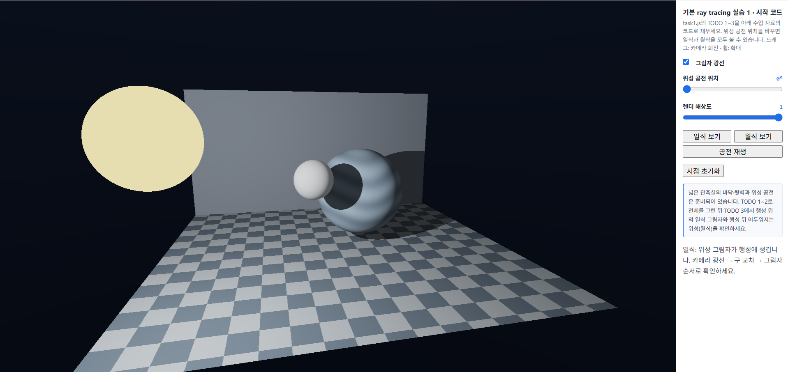
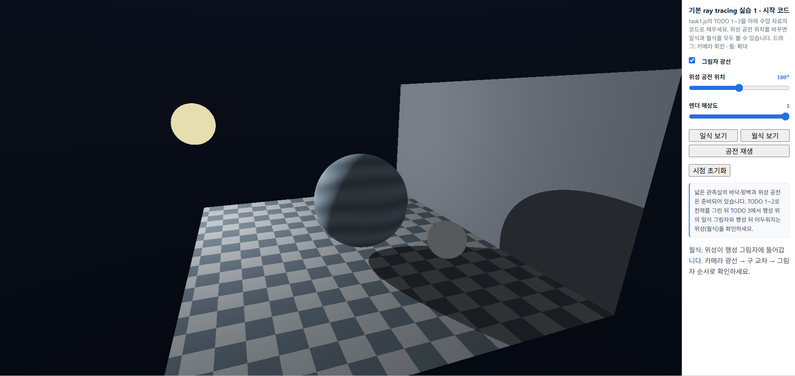
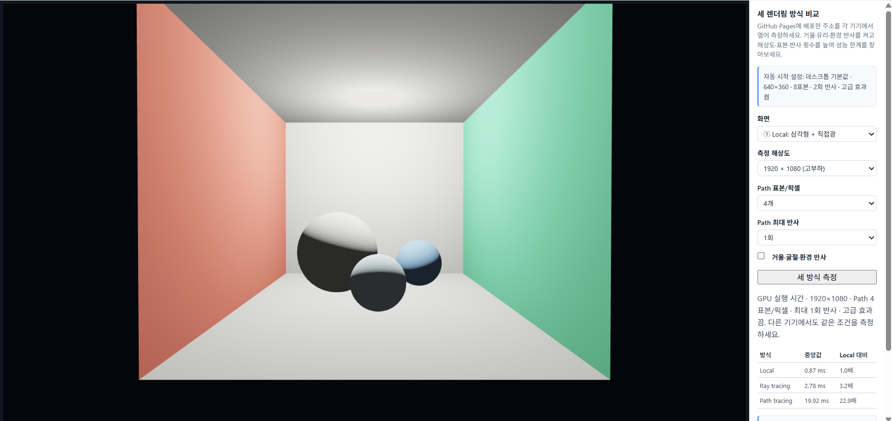

# 7주차 실습 보고서

## 1. 실습 1 — 기본 Ray Tracing으로 일식·월식 구현

(https://hongchaeyeon413.github.io/cg-2026-solar/week7/task1.html)

### 1-1. 실습 목표

이번 실습에서는 기본 Ray Tracing을 이용하여 별, 행성, 위성이 있는 장면을 구현하고, 위성의 공전 위치에 따라 일식과 월식이 발생하는 원리를 관찰하였습니다.

기존의 삼각형 메시를 이용하는 렌더링 방식과 달리, 화면을 덮는 사각형을 그린 후 각 픽셀에서 광선을 생성하고 장면에 있는 구와 바닥, 벽의 교차 여부를 계산하도록 구현하였습니다.

이를 통해 카메라 광선 생성, 광선과 구의 교차 검사, 직접광 계산 및 그림자 광선의 역할을 확인하였습니다.

### 1-2. TODO 1 — 픽셀마다 카메라 광선 만들기

`cameraRay()` 함수에서 픽셀 좌표를 화면 중앙이 원점이 되도록 변환하고, 카메라의 방향을 나타내는 `forward`, `right`, `up` 벡터를 계산하였습니다.

```glsl
vec2 uv=(2.0*pixel-uRes)/uRes.y;
vec3 target=vec3(0.0,0.0,-1.8);
vec3 forward=normalize(target-eye);
vec3 right=normalize(cross(forward,vec3(0.0,1.0,0.0)));
vec3 up=cross(right,forward);
return normalize(1.7*forward+uv.x*right+uv.y*up);
```

화면의 각 픽셀에서 카메라 방향으로 서로 다른 광선이 생성되도록 하였습니다. `forward`는 카메라가 바라보는 방향, `right`는 화면의 오른쪽 방향, `up`은 화면의 위쪽 방향을 나타냅니다.

**실행 결과:** 방의 바닥과 뒷벽이 원근감 있게 나타났으며, 카메라를 드래그하면 바라보는 방향에 따라 화면에 보이는 면이 달라지는 것을 확인하였습니다.


### 1-3. TODO 2 — 광선과 구의 교차 거리 찾기

`hitSphere()` 함수에서 광선과 구의 교차 여부 및 교차 거리를 계산하였습니다.

```glsl
vec3 oc=ro-center;
float a=dot(rd,rd);
float halfB=dot(oc,rd);
float c=dot(oc,oc)-radius*radius;
float disc=halfB*halfB-a*c;
if(disc<0.0)return -1.0;
float root=sqrt(disc);
float t=(-halfB-root)/a;
if(t>0.002)return t;
t=(-halfB+root)/a;
return t>0.002?t:-1.0;
```

광선과 구의 교차를 판별하기 위해 판별식 `disc`를 계산하였습니다. 판별식이 0보다 작으면 교차하지 않는 것이므로 `-1.0`을 반환합니다.

교차하는 경우에는 두 개의 교차 거리 중 가까운 양수 거리를 선택합니다. 광선이 구 내부에서 시작하는 경우에도 바깥쪽 교차점을 찾을 수 있도록 두 번째 근까지 확인하였습니다.

시작 코드의 `traceScene()`은 별, 행성, 위성뿐 아니라 바닥과 뒷벽까지 검사하여 가장 가까운 교차 지점을 선택합니다.

**실행 결과:** 별, 행성, 위성이 화면에 나타났으며, 각 천체가 평평한 색으로 표시되는 것을 확인하였습니다. 이 단계에서는 아직 다른 물체에 의한 그림자는 계산하지 않았습니다.


### 1-4. TODO 3 — 직접광과 식의 그림자 구현

`shade()` 함수에서 별을 자체 발광 물체로 처리하고, 행성과 바닥 및 벽에는 별에서 오는 직접광을 계산하도록 구현하였습니다.

```glsl
if(id==0)return uColors[0];
vec3 p=ro+t*rd;
vec3 N=id==3?vec3(0.0,1.0,0.0):id==4?vec3(0.0,0.0,1.0):normalize(p-uBodies[id].xyz);
vec3 toStar=uBodies[0].xyz-p;
float lightDistance=length(toStar);
vec3 L=toStar/lightDistance;
float visible=1.0;
if(uShadow==1){
  int blockerId;
  float blockerT=traceScene(p+N*0.004,L,blockerId);
  if(blockerId>0&&blockerT<lightDistance-0.004)visible=0.0;
}
float diffuse=max(dot(N,L),0.0);
float power=4.0/(1.0+0.18*lightDistance*lightDistance);
float ambient=id==2?0.13:0.045;
return surfaceColor(id,p)*(ambient+visible*diffuse*power);
```

교차 지점에서 별을 향하는 광선인 그림자 광선을 생성하고, 그 사이에 다른 물체가 존재하는지 확인하도록 하였습니다. 다른 물체가 빛을 가로막으면 `visible`을 0으로 설정하여 직접광이 도달하지 않도록 하였습니다.

바닥과 벽은 구가 아니므로 각각 위쪽과 앞쪽을 향하는 별도의 법선을 사용하였습니다. 또한 `p+N*0.004`를 적용하여 그림자 광선이 자기 표면과 다시 교차하는 현상을 줄였습니다.

위성에는 주변광을 조금 더 적용하여 월식 중에도 위성의 윤곽을 확인할 수 있도록 하였습니다. 이는 관찰을 위한 단순화이며 실제 대기에 의해 굴절되는 붉은빛을 계산한 것은 아닙니다.

**실행 결과:** 그림자 광선을 켜고 끄면서 행성 표면과 바닥에 나타나는 그림자의 차이를 확인하였습니다.

### 1-5. 일식과 월식 관찰

이번 실습에서는 위성의 공전 위치에 따라 일식과 월식이 발생하도록 구성하였습니다. 실제 천체의 크기와 거리 비율을 재현한 것이 아니라, 식의 원리를 관찰하기 위한 교육용 배치입니다.

**① 일식 — 공전 위치 0°**

별, 위성, 행성 순서로 배치됩니다. 별에서 행성으로 향하는 빛을 위성이 가로막으면서 행성 표면에 위성의 그림자가 생깁니다.



**② 월식 — 공전 위치 180°**

별, 행성, 위성 순서로 배치됩니다. 행성이 별빛을 가로막으면서 위성이 행성의 그림자 영역에 들어가 어두워집니다.




### 1-6. 실습 1 결과 및 정리

이번 실습을 통해 기본 Ray Tracing의 처리 과정을 확인하였습니다.

- **카메라 광선 생성:** 화면의 각 픽셀에서 서로 다른 방향의 광선을 생성하였습니다.
- **교차 검사:** 광선과 구, 바닥, 벽의 교차 여부를 계산하고 가장 가까운 물체를 찾았습니다.
- **직접광 계산:** 표면의 법선과 별 방향을 이용하여 빛의 밝기를 계산하였습니다.
- **그림자 광선:** 별과 표면 사이에 다른 물체가 존재하는지 검사하여 그림자를 표현하였습니다.

특히 위성의 공전 위치를 바꾸는 것만으로 일식과 월식의 차이를 확인할 수 있었으며, 그림자 광선을 끄고 켜면서 물체가 빛을 가리는 원리를 이해하였습니다.

---

## 2. 실습 2 — 여러 기기에서 화질·성능 측정 및 자동 설정

(https://hongchaeyeon413.github.io/cg-2026-solar/week7/task2.html)

### 2-1. 실습 목표

같은 장면을 Local Rasterization, Ray Tracing, Path Tracing의 세 가지 방식으로 렌더링하고, 서로 다른 기기에서 실행 시간과 화질을 비교하였습니다.

해상도, Path 표본 수, 최대 반사 횟수, 고급 효과 설정을 변경하면서 기기별 성능 차이를 확인하고, 측정 결과에 따라 기기에 적합한 렌더링 설정이 자동으로 적용되도록 구현하는 것이 목표입니다.

### 2-2. 세 가지 렌더링 방식

이번 실습에서는 동일한 방과 물체를 세 가지 렌더링 방식으로 표현하였습니다.

| 렌더링 방식 | 특징 |
|---|---|
| Local Rasterization | 삼각형 메시와 직접광을 이용합니다. 다른 물체에 의한 그림자와 거울·유리 효과는 표현하지 않습니다. |
| Ray Tracing | 픽셀에서 광선을 생성하고 물체와의 교차 및 그림자 광선을 계산합니다. 고급 효과 설정에 따라 거울 반사와 유리 굴절도 표현합니다. |
| Path Tracing | 여러 광선 경로를 표본 추출하여 확산 반사와 간접광을 표현합니다. 표본 수와 반사 횟수에 따라 계산량이 달라집니다. |

고급 효과를 켜면 거울 구체는 주변 환경을 반사하고, 유리 구체는 광선의 굴절을 표현합니다. Local Rasterization은 삼각형과 직접광만 사용하기 때문에 해당 물체들도 불투명한 형태로 나타납니다.

### 2-3. 성능 측정 항목

실습에서 조절한 항목은 다음과 같습니다.

| 항목 | 설정 범위 | 확인 내용 |
|---|---|---|
| 해상도 | 320×180 ~ 1920×1080 | 픽셀 수 증가에 따른 렌더링 시간 변화 |
| Path 표본/픽셀 | 4, 8, 16, 32 | 표본 수 증가에 따른 노이즈 감소와 계산량 변화 |
| Path 최대 반사 | 1, 2, 3, 4회 | 간접광·거울·유리 경로와 교차 검사 증가 |
| 고급 효과 | 켬 / 끔 | 거울 반사, 유리 굴절, 환경 반사에 따른 성능 변화 |

해상도가 높아지면 처리해야 하는 픽셀 수가 증가합니다. Path 표본 수가 증가하면 여러 경로의 결과를 평균하여 노이즈를 줄일 수 있지만 계산량도 증가합니다. 최대 반사 횟수를 높이면 한 경로에서 더 많은 반사와 교차 검사를 수행할 수 있습니다.

### 2-4. 기기 정보

서로 다른 두 기기에서 동일한 GitHub Pages 주소에 접속하여 실험하였습니다.

| 구분 | 기기 A | 기기 B |
|---|---|---|
| 기기 종류 | 노트북 | 스마트폰 |
| CPU | 13th Gen Intel(R) Core(TM) i5-1335U(1.30 GHz) | Snapdragon 8 Gen 3 for Galaxy |
| GPU | Intel(R) Iris(R) Xe Graphics (128 MB) |  Adreno 750 |
| 운영체제 |  Windows 11 Pro | Android |
| 브라우저 | Google Chrome | Google Chrome |
| 전원 상태 | 배터리 | 배터리 |

### 2-5. 공통 조건에서의 성능 비교

기기 간 성능을 비교하기 위해 두 기기 모두 동일한 조건을 적용하였습니다.

- 해상도: 640×360
- Path 표본/픽셀: 8개
- Path 최대 반사: 2회
- 고급 효과: 켬

각 렌더링 방식은 첫 실행을 제외하고 5회 측정한 결과의 중앙값을 기록하였습니다.

| 기기 | 조건 | Local | Ray Tracing | Path Tracing |
|---|---|---:|---:|---:|
| 기기 A | 640×360 / 8 / 2 / 켬 | (0.28 ) ms | (0.78 ) ms | (13.17 ) ms |
| 기기 B | 640×360 / 8 / 2 / 켬 | (2.00 ) ms | (1.80 ) ms | ( 9.50 ) ms |

**관찰 및 분석**

기기 A는 살짝 버벅거렸지만 기기 B는 전혀 버벅거리지않고 로딩이 잘되었습니다.

### 2-6. 고부하 조건에서의 성능 비교

각 설정을 한 번에 하나씩 높이면서 렌더링 시간과 화면 반응을 확인하였습니다. 해상도, 표본 수, 최대 반사 횟수, 고급 효과를 변경하여 어느 조건부터 성능 저하가 나타나는지 관찰하였습니다.

| 기기 | 고부하 조건 | Local | Ray Tracing | Path Tracing | 관찰 |
|---|---|---:|---:|---:|---|
| 기기 A |  960x540 / 16 / 3 / 켬 | ( 0.50 ) ms | ( 2.86 ) ms | ( 17.73 ) ms | 고급효과키면 눈에 띄게 버벅거리기 시작했습니다. |
| 기기 B | 1280 x720 / 32 / 3 / 켬 | ( 1.70 ) ms | ( 5.10 ) ms | ( 75.00 ) ms | 스크롤이 버벅거리기 시작했습니다. |


### 2-7. 기기별 적정 렌더링 설정 선정

각 기기에서 렌더링 시간과 화질을 함께 고려하여 적정 설정을 선정하였습니다. 단순히 가장 높은 설정을 선택하는 것이 아니라, 사용자가 기다릴 수 있는 시간 안에서 가장 좋은 화질을 제공하는 조건을 선택하였습니다.

| 기기 | 적정 설정 | Local | Ray Tracing | Path Tracing | 선정 이유 |
|---|---|---:|---:|---:|---|
| 기기 A | (1920x1080(고부하) / 4 / 1 / 켬 ) | ( 0.87 ) ms | ( 2.78 ) ms | ( 19.92 ) ms | 화질이 좋은걸 기준으로 삼았습니다. 노트북은 적정수준도 살짝 버벅거렸기 때문에 화질이라도 좋게 하는게 나을 것 같다고 판단했습니다. |
| 기기 B | ( 1280x720 / 16 / 4 / 켬) | ( 3.00 ) ms | ( 5.20 ) ms | ( 37.90 ) ms | 스마트폰은 노트북과 다르게 화면이 작다보니 내용이 짤려서 위아래로 스크롤을 자주하는데, 스크롤이 버벅거리지 않고 잘 되는 것을 기준으로 했습니다. |


### 2-8. 기기별 자동 설정 구현

기기마다 적합한 렌더링 설정을 자동으로 적용하기 위해 `task2.js`의 `chooseInitialProfile()` 함수를 수정하였습니다.

```javascript
function chooseInitialProfile(){
  return readSavedProfile();
}
```

기기 구분에는 `navigator.userAgentData?.mobile`과 `matchMedia('(pointer:coarse)').matches`를 사용하였습니다.

- 모바일로 판단되면 `mobile` 프로파일을 사용합니다.
- 그 외에는 `desktop` 프로파일을 사용합니다.
- 기기 유형에 따라 서로 다른 `localStorage` 키를 사용하여 설정을 저장하고 불러옵니다.

초기 프로파일은 다음과 같이 설정하였습니다.

| 구분 | 해상도 | 표본/픽셀 | 최대 반사 | 고급 효과 |
|---|---:|---:|---:|---|
| Desktop 기본값 | 1920×1080 | 4 | 1회 | 켬 |
| Mobile 기본값 | 1280×720 | 16 | 4회 | 끔 |

`readSavedProfile()` 함수는 `localStorage`에 저장된 설정을 불러오며, 저장된 값이 없거나 유효하지 않으면 기기 유형에 따른 기본 프로파일을 반환합니다.

`saveProfile()` 함수는 현재 해상도, 표본 수, 최대 반사 횟수, 고급 효과 설정을 `localStorage`에 저장합니다. 세 가지 렌더링 방식 측정이 완료되면 현재 설정을 저장하도록 하였습니다.

또한 `updateProfileLabel()` 함수를 통해 현재 적용된 기기 유형과 렌더링 설정이 화면의 `#profile` 영역에 표시되도록 구현하였습니다.

이를 통해 같은 브라우저에서 다시 접속하거나 새로고침했을 때 이전에 측정하여 저장한 설정을 불러올 수 있도록 구현하였습니다.

### 2-9. 자동 설정 및 새로고침 확인

기기별로 GitHub Pages에 접속하여 자동으로 적용되는 설정을 확인하였습니다.

**기기 A — 자동 설정 화면**




**기기 B — 자동 설정 화면**


확인 결과: 새로고침 후 저장된 설정이 유지되고, 기기별로 서로 다른 설정이 적용되었습니다.


### 2-10. 실습 2 결과 및 정리

이번 실습에서는 동일한 장면을 Local Rasterization, Ray Tracing, Path Tracing으로 렌더링하고, 서로 다른 기기에서 실행 시간을 비교하였습니다.

해상도와 Path 표본 수, 최대 반사 횟수, 고급 효과 설정에 따라 렌더링 시간과 화면 표현이 달라지는 것을 확인하였습니다.

또한 `localStorage`를 이용하여 기기 유형별 설정을 저장하고 불러오는 기능을 구현하였습니다. 이를 통해 사용자가 매번 수동으로 설정하지 않아도 이전에 저장한 렌더링 설정이 자동으로 적용되도록 하였습니다.